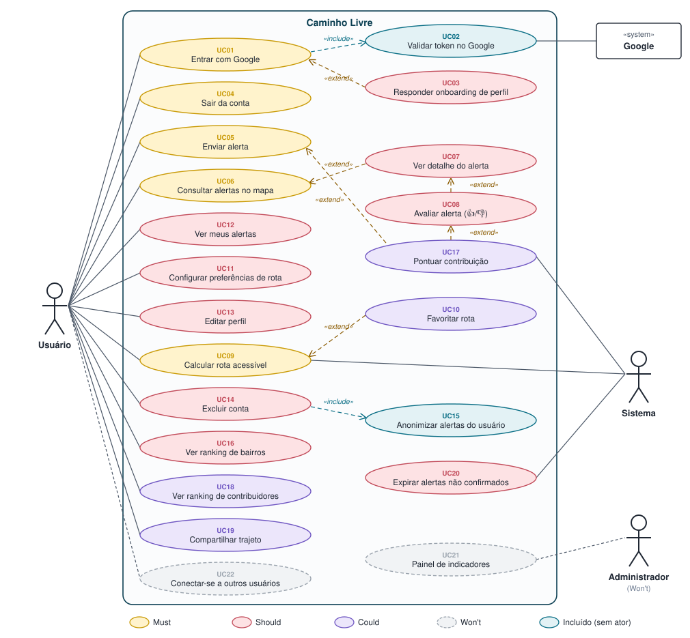
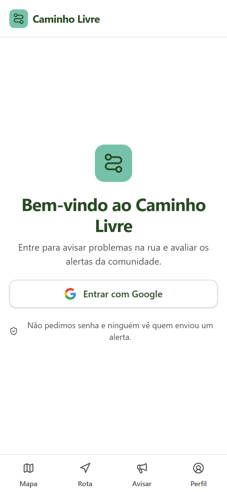
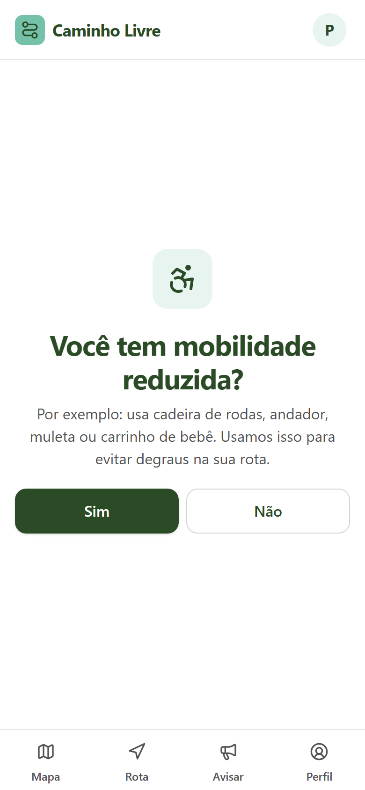
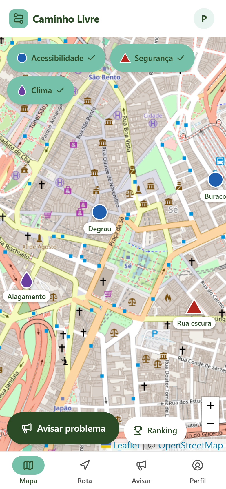
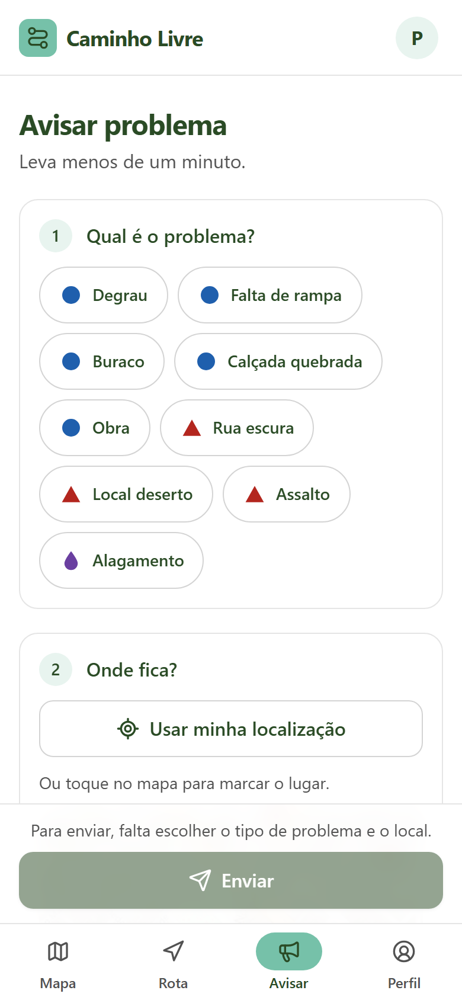
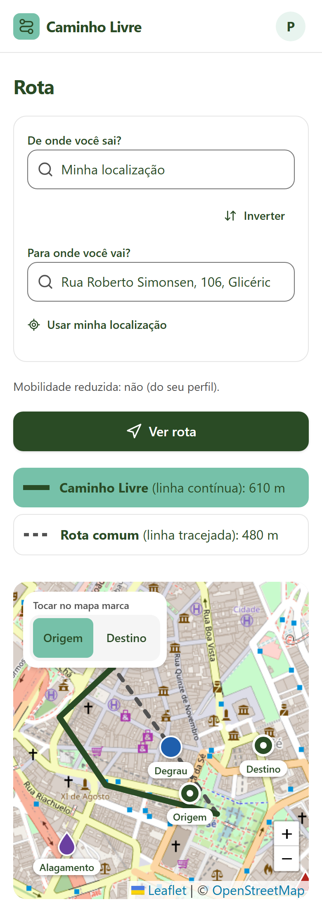
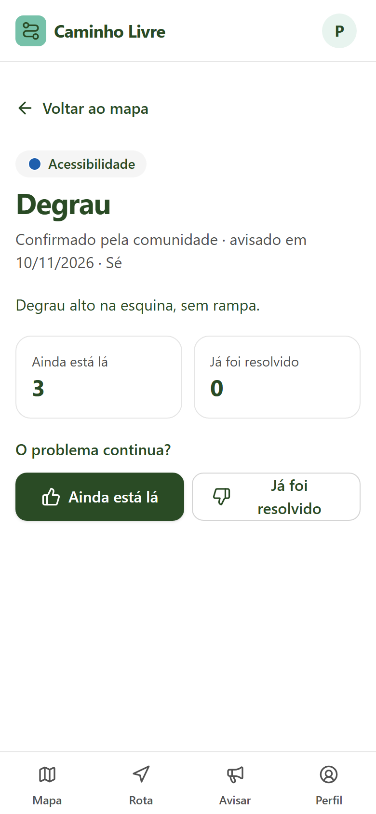

 

Caminho Livre

O mapa da cidade que mostra o que o GPS não vê

 

AGILE METHODOLOGY WITH SQUAD FRAMEWORK

Global Solution 2026.2 — CitizenTech

 

**Apresentação da Ideia · Personas · Diagrama de Casos de Uso · Backlog do Produto · Requisitos · Protótipo · Pitch**

  

**GRUPO OCTOFLOW**

| Integrante                           |   RM   |
| :----------------------------------- | :----: |
| **Henrique Castro de Matos**         | 564560 |
| **Caio Nascimento Caminha**          | 564789 |
| **Eduardo Ulisses Pereira da Silva** | 566339 |
| **Eduardo Duran Del Ciel**           | 562017 |
| **Laura Tigre Amaral**               | 565281 |

 

|               |                                        |
| :------------ | :------------------------------------- |
| **Turma**     | 2ESPV — Engenharia de Software, 2º ano |
| **Professor** | Henrique Cordeiro                      |
| **Entrega**   | Global Solution 2026.2 — 19/11/2026    |

  

_FIAP — Faculdade de Informática e Administração Paulista_

Sumário

- [1. Apresentação da Ideia](#1-apresentação-da-ideia)
  - [1.1 O problema](#11-o-problema)
  - [1.2 Foco](#12-foco)
  - [1.3 Público-alvo](#13-público-alvo)
  - [1.4 A solução](#14-a-solução)
  - [1.5 Justificativas das escolhas](#15-justificativas-das-escolhas)
  - [1.6 Ecossistema e impacto](#16-ecossistema-e-impacto)
- [2. Personas](#2-personas)
  - [2.4 O que as personas têm em comum](#24-o-que-as-personas-têm-em-comum)
- [3. Diagrama de Casos de Uso](#3-diagrama-de-casos-de-uso)
  - [3.1 Atores e sistemas externos](#31-atores-e-sistemas-externos)
  - [3.2 Diagrama](#32-diagrama)
  - [3.3 Documentação dos casos de uso](#33-documentação-dos-casos-de-uso)
  - [3.4 Relacionamentos «include» e «extend»](#34-relacionamentos-include-e-extend)
- [4. Backlog do Produto](#4-backlog-do-produto)
  - [4.1 Histórias de usuário priorizadas (MoSCoW)](#41-histórias-de-usuário-priorizadas-moscow)
  - [4.2 Escopo do MVP](#42-escopo-do-mvp)
  - [4.3 Requisitos funcionais](#43-requisitos-funcionais)
  - [4.4 Requisitos não funcionais](#44-requisitos-não-funcionais)
- [5. Protótipo](#5-protótipo)
  - [5.1 Decisões gerais de UX e UI](#51-decisões-gerais-de-ux-e-ui)
  - [5.2 Telas](#52-telas)
- [6. Vídeo Pitch](#6-vídeo-pitch)

## 1. Apresentação da Ideia

### 1.1 O problema

**Quem anda a pé não sabe quais calçadas são intransitáveis nem quais ruas estão escuras, alagadas ou perigosas, e os aplicativos de rota ignoram isso.**

Os aplicativos de navegação calculam o caminho mais curto ou mais rápido, mas tratam toda calçada como transitável e toda rua como segura a qualquer hora. Para boa parte das pessoas que circulam a pé, essa premissa é falsa:

| Situação real                              | Quem é afetado                                                 | O que acontece hoje                                               |
| :----------------------------------------- | :------------------------------------------------------------- | :---------------------------------------------------------------- |
| Calçada quebrada, degrau sem rampa, buraco | Cadeirantes, idosos, pais com carrinho de bebê                 | A pessoa descobre o obstáculo no meio do trajeto e precisa voltar |
| Rua escura ou deserta à noite              | Estudantes e trabalhadores que voltam a pé, sobretudo mulheres | A rota é escolhida sem informação                                 |
| Rua alagada em dia de chuva                | Todos os pedestres, especialmente os mais vulneráveis          | O risco só é percebido ao chegar ao local                         |

A informação existe: quem passa todos os dias pela rua sabe onde está o degrau, qual poste está apagado e que esquina alaga. O que falta é um lugar para registrá-la e uma forma de usá-la no momento de escolher o caminho.

### 1.2 Foco

O Caminho Livre foca no **deslocamento a pé em trajetos curtos do dia a dia** (casa → posto de saúde, faculdade → metrô, casa → mercado), em que pequenos obstáculos decidem se a pessoa consegue ou não sair de casa sozinha.

Ficam fora do foco a navegação de veículos, o transporte público e a denúncia formal ao poder público: o produto informa o cidadão e gera dados que podem apoiar a zeladoria, mas não substitui os canais oficiais.

### 1.3 Público-alvo

| Segmento                                    | Necessidade principal                                                         |
| :------------------------------------------ | :---------------------------------------------------------------------------- |
| **Pessoas com mobilidade reduzida**         | Saber antes de sair se o trajeto tem barreira física                          |
| **Pedestres que circulam à noite**          | Evitar ruas escuras e desertas                                                |
| **Pessoas com baixa familiaridade digital** | Conseguir usar o app sozinhas, com poucos toques e texto simples              |
| **Moradores engajados com o bairro**        | Ter um canal rápido para registrar problemas e ver o efeito do que reportaram |

### 1.4 A solução

O Caminho Livre é um **mapa colaborativo de obstáculos e trechos inseguros**, combinado a um **cálculo de rota acessível**.

1. **O usuário entra com a conta Google**, sem cadastro nem senha, e informa se tem mobilidade reduzida.
2. **Ele registra um alerta** em poucos toques: foto, categoria (degrau, buraco, calçada quebrada, rua escura, alagamento etc.) e local.
3. **A comunidade valida.** Outros usuários confirmam (👍) ou negam (👎) o alerta. Com 3 confirmações ele fica confirmado; com 3 negações, resolvido. Alertas sem confirmação expiram em 15 dias, para o mapa não envelhecer.
4. **O sistema calcula a rota.** Cada trecho de rua recebe um peso que soma a distância e a gravidade dos alertas próximos, com peso maior à noite para alertas de segurança. Para quem tem mobilidade reduzida, um degrau torna o trecho intransponível.
5. **O usuário vê as duas rotas lado a lado**: a rota comum e a rota Caminho Livre, com a distância de cada uma.

### 1.5 Justificativas das escolhas

| Escolha                                            | Justificativa                                                                                                                                                |
| :------------------------------------------------- | :----------------------------------------------------------------------------------------------------------------------------------------------------------- |
| **Dados colaborativos**                            | Ninguém conhece melhor a calçada do que quem passa por ela. O custo de coleta é zero e o mapa se atualiza na velocidade da rua.                              |
| **Validação pela comunidade e expiração**          | Um mapa colaborativo só é útil se for confiável. Confirmação, negação e prazo de validade evitam alertas falsos e desatualizados.                            |
| **Rota com pesos por perfil e horário**            | O mesmo trecho é seguro de dia e arriscado à noite, e transitável para uns e intransponível para outros. Uma rota única não atende a todos.                  |
| **Login com Google**                               | Elimina cadastro e senha, que são as maiores barreiras para quem tem pouca familiaridade digital. O app não guarda senha, o que reduz risco (LGPD).          |
| **Interface acessível como requisito transversal** | O público mais beneficiado é justamente o que mais tem dificuldade com tecnologia: letras grandes, alto contraste e poucos passos valem para todas as telas. |

### 1.6 Ecossistema e impacto

| Participante                                  | Papel                                                        |
| :-------------------------------------------- | :----------------------------------------------------------- |
| Cidadãos                                      | Registram, confirmam e usam as rotas                         |
| Pessoas com deficiência e coletivos de bairro | Validam a utilidade e divulgam o app na comunidade           |
| Subprefeitura / zeladoria (SP156)             | Pode usar os dados agregados para priorizar consertos        |
| Concessionária de iluminação                  | Pode usar os alertas de rua escura para priorizar manutenção |

**Indicadores de impacto:** percentual de obstáculos e trechos escuros evitados por rota, alertas resolvidos por mês e tempo médio até a resolução.

**ODS conectados:** **ODS 10** (redução das desigualdades), **ODS 11** (cidades e comunidades sustentáveis), **ODS 3** (saúde e bem-estar) e **ODS 9** (indústria, inovação e infraestrutura).

## 2. Personas

As personas representam os três perfis que mais sofrem com a falta de informação sobre as ruas. Elas orientaram a priorização do backlog e as decisões de interface.

2.1 Dona Marta 68 anos · aposentada · usa andador

Dona Marta mora sozinha a 600 metros do posto de saúde, onde vai toda semana medir a pressão. Desde que passou a usar andador, esse trajeto curto virou uma decisão difícil: há um trecho de calçada quebrada no meio do caminho, e uma guia alta sem rampa na esquina. Na última vez em que tentou, precisou voltar no meio do caminho e pedir ajuda a um desconhecido para atravessar. Desde então, quando a filha não pode acompanhá-la, ela prefere remarcar a consulta. Usa o celular apenas para falar com a família pelo WhatsApp.

<strong style="color:#a8456a;">Dores ·</strong> Descobre o obstáculo só quando chega nele. Não sabe se existe um caminho alternativo sem degraus. Sente que depende dos outros para sair.

<strong style="color:#2f7d4f;">Objetivos ·</strong> Ir ao posto de saúde sozinha e com segurança. Saber antes de sair qual caminho consegue fazer.

<strong>Histórias ligadas:</strong> US03 · US04 · US12

2.2 Júlia 21 anos · estudante universitária

Júlia estuda à noite e sai da faculdade às 23h. Do portão até a estação de metrô são dez minutos a pé, e ela conhece de cor as ruas que evita: uma com dois postes apagados há semanas, outra que fica deserta depois que as lojas fecham. Quando o aplicativo de mapas sugere justamente essas ruas, ela ignora e muda de rota, às vezes andando o dobro. Usa o celular o tempo todo e já avisou as amigas da turma, pelo grupo, sobre os pontos que considera perigosos, mas essa informação se perde nas conversas.

<strong style="color:#a8456a;">Dores ·</strong> Os apps de rota não sabem que a rua está escura. A informação que ela e as amigas têm não fica registrada em lugar nenhum.

<strong style="color:#2f7d4f;">Objetivos ·</strong> Voltar para casa por ruas iluminadas e movimentadas. Avisar outras pessoas sobre os trechos perigosos de forma rápida.

<strong>Histórias ligadas:</strong> US02 · US04 · US07 · US20

2.3 Seu Antônio 74 anos · aposentado · baixa familiaridade digital

Seu Antônio mora numa rua que alaga sempre que chove forte. Já ficou ilhado no caminho da padaria e, em outra ocasião, quase caiu ao pisar num buraco escondido pela água. Ganhou um smartphone dos filhos, mas usa pouco: tem dificuldade com letras pequenas, se perde em telas cheias de botões e desiste quando o aplicativo pede cadastro e senha. Gosta de ajudar os vizinhos e seria o primeiro a avisar a rua inteira quando a esquina alaga — se soubesse como.

<strong style="color:#a8456a;">Dores ·</strong> Aplicativos complicados, com letras pequenas e muitos passos. Esquece senhas. Não sabe quando a rua está alagada até chegar nela.

<strong style="color:#2f7d4f;">Objetivos ·</strong> Usar o app sozinho, sem pedir ajuda aos filhos. Avisar os vizinhos sobre o alagamento.

<strong>Histórias ligadas:</strong> US01 · US02 · US05

### 2.4 O que as personas têm em comum

| Necessidade                             | Dona Marta | Júlia | Seu Antônio | Como o produto responde                              |
| :-------------------------------------- | :--------: | :---: | :---------: | :--------------------------------------------------- |
| Saber o que há no caminho antes de sair |     ●      |   ●   |      ●      | Mapa de alertas (US03)                               |
| Uma rota que respeite a sua condição    |     ●      |   ●   |             | Rota acessível com pesos por perfil e horário (US04) |
| Registrar o problema com facilidade     |            |   ●   |      ●      | Envio de alerta em até 4 toques (US02)               |
| Interface simples e legível             |     ●      |       |      ●      | Interface acessível e login Google (US01, US05)      |

## 3. Diagrama de Casos de Uso

O diagrama mostra o **escopo total** do Caminho Livre: todos os atores e todas as funcionalidades do backlog, inclusive as que ficam fora desta entrega (Won't), que aparecem tracejadas. A cor de cada caso de uso indica a prioridade MoSCoW da história de origem.

### 3.1 Atores e sistemas externos

| Ator                        | Tipo            | Papel na solução                                                                                                                     |
| :-------------------------- | :-------------- | :----------------------------------------------------------------------------------------------------------------------------------- |
| **Usuário**                 | Ator primário   | Qualquer pessoa que circula a pé. Registra, confirma e consulta alertas e pede rotas. No perfil, informa se tem mobilidade reduzida. |
| **Sistema**                 | Ator secundário | Rotinas automáticas: cálculo de rota, pontuação e expiração de alertas não confirmados.                                              |
| **Google**                  | «system»        | Serviço externo de autenticação (login social).                                                                                      |
| **Administrador** _(Won't)_ | Ator primário   | Acompanharia indicadores. Fica fora desta entrega, mas aparece no diagrama para mostrar o escopo total.                              |

### 3.2 Diagrama

### 3.3 Documentação dos casos de uso

| ID       | Caso de uso                     | Ator             | Descrição                                                                                                    | Prioridade | Histórias  |
| :------- | :------------------------------ | :--------------- | :----------------------------------------------------------------------------------------------------------- | :--------: | :--------- |
| **UC01** | Entrar com Google               | Usuário          | Acessa o app com a conta Google. No primeiro acesso, a conta é criada com nome, e-mail e foto.               |    Must    | US01       |
| **UC02** | Validar token no Google         | Google «system»  | Confere no back-end o token devolvido pelo Google antes de liberar o acesso.                                 |    Must    | US01       |
| **UC03** | Responder onboarding de perfil  | — _(extensão)_   | No primeiro acesso, pergunta se o usuário tem mobilidade reduzida.                                           |   Should   | US12       |
| **UC04** | Sair da conta                   | Usuário          | Encerra a sessão no aparelho.                                                                                |    Must    | US06       |
| **UC05** | Enviar alerta                   | Usuário          | Registra um alerta com foto, categoria (incluindo alagamento) e local, pelo GPS ou tocando no mapa.          |    Must    | US02       |
| **UC06** | Consultar alertas no mapa       | Usuário          | Vê os alertas ativos no mapa, com cor e ícone por tipo, e filtra por Acessibilidade, Segurança e Alagamento. |    Must    | US03       |
| **UC07** | Ver detalhe do alerta           | — _(extensão)_   | A partir do mapa, abre um alerta e vê foto, descrição, data, status e total de 👍/👎.                        |   Should   | US09       |
| **UC08** | Avaliar alerta (👍/👎)          | — _(extensão)_   | No detalhe, confirma ou nega um alerta de outra pessoa, uma única vez.                                       |   Should   | US07       |
| **UC09** | Calcular rota acessível         | Usuário, Sistema | Informa origem e destino e recebe a rota que desvia dos alertas, comparada à rota comum.                     |    Must    | US04       |
| **UC10** | Favoritar rota                  | — _(extensão)_   | Salva a rota calculada para acessá-la depois.                                                                |   Could    | US16       |
| **UC11** | Configurar preferências de rota | Usuário          | Liga e desliga os tipos de alerta que a rota deve considerar.                                                |   Should   | US11       |
| **UC12** | Ver meus alertas                | Usuário          | Lista os alertas que enviou, com o status de cada um.                                                        |   Should   | US10       |
| **UC13** | Editar perfil                   | Usuário          | Altera nome, foto e a indicação de mobilidade reduzida.                                                      |   Should   | US12, US13 |
| **UC14** | Excluir conta                   | Usuário          | Após confirmação, apaga os dados pessoais e a conta.                                                         |   Should   | US15       |
| **UC15** | Anonimizar alertas do usuário   | — _(incluído)_   | Mantém os alertas da conta excluída no mapa, sem vínculo com a pessoa (LGPD).                                |   Should   | US15       |
| **UC16** | Ver ranking de bairros          | Usuário          | Consulta os bairros com mais e menos alertas ativos, ponderados pela gravidade.                              |   Should   | US14       |
| **UC17** | Pontuar contribuição            | Sistema          | Soma +10 pontos ao enviar e +2 ao avaliar um alerta.                                                         |   Could    | US17, US18 |
| **UC18** | Ver ranking de contribuidores   | Usuário          | Consulta os usuários com mais pontos.                                                                        |   Could    | US19       |
| **UC19** | Compartilhar trajeto            | Usuário          | Envia a um contato um link para acompanhar o trajeto em tempo real.                                          |   Could    | US20       |
| **UC20** | Expirar alertas não confirmados | Sistema          | Marca como expirados os alertas sem confirmação 15 dias após o registro.                                     |   Should   | US08       |
| **UC21** | Painel de indicadores           | Administrador    | Acompanha indicadores de uso e de impacto.                                                                   |   Won't    | US21       |
| **UC22** | Conectar-se a outros usuários   | Usuário          | Segue e conversa com outros usuários.                                                                        |   Won't    | US22       |

### 3.4 Relacionamentos «include» e «extend»

| Origem | Tipo      | Destino | Justificativa                                                                                         |
| :----- | :-------- | :------ | :---------------------------------------------------------------------------------------------------- |
| UC01   | «include» | UC02    | Todo login **obrigatoriamente** valida o token no Google; o app não guarda senha (RNF06).             |
| UC14   | «include» | UC15    | Excluir a conta sempre anonimiza os alertas enviados, para o mapa não perder informação (RF21, LGPD). |
| UC03   | «extend»  | UC01    | O onboarding só acontece no **primeiro** acesso.                                                      |
| UC07   | «extend»  | UC06    | O detalhe é opcional: o mapa já cumpre seu objetivo sem que o usuário abra um alerta.                 |
| UC08   | «extend»  | UC07    | A avaliação é feita a partir do detalhe, quando o usuário decide confirmar ou negar.                  |
| UC10   | «extend»  | UC09    | Favoritar é uma opção depois de calcular a rota.                                                      |
| UC17   | «extend»  | UC05    | A pontuação (Could) é um comportamento opcional acrescentado ao envio de alerta.                      |
| UC17   | «extend»  | UC08    | Idem para a avaliação de alerta.                                                                      |

## 4. Backlog do Produto

O backlog nasceu do quadro MoSCoW construído pela equipe, a partir das dores das personas. Notas duplicadas no quadro foram unificadas, e cada história recebeu uma estimativa em story points por **Planning Poker** (escala Fibonacci: 1, 2, 3, 5, 8, 13).

### 4.1 Histórias de usuário priorizadas (MoSCoW)

**🟨 Must have — MVP**

| ID       | História                                                                                                                                                                                      | SP  |
| :------- | :-------------------------------------------------------------------------------------------------------------------------------------------------------------------------------------------- | :-: |
| **US01** | Como **usuário**, quero **entrar com a minha conta Google** para acessar o app sem precisar criar e lembrar uma senha.                                                                        |  5  |
| **US02** | Como **usuário**, quero **enviar um alerta** com foto, categoria (degrau, buraco, calçada quebrada, rua escura, alagamento etc.) e local para avisar outras pessoas sobre um problema na rua. |  5  |
| **US03** | Como **usuário**, quero **ver os alertas no mapa**, filtrando por tipo (acessibilidade, segurança e alagamento), para saber o que vou encontrar no caminho.                                   |  5  |
| **US04** | Como **usuário**, quero **receber uma rota acessível que desvie dos alertas** para chegar ao destino sem barreiras.                                                                           | 13  |
| **US05** | Como **usuário com pouca familiaridade com tecnologia**, quero uma **interface acessível** (letras grandes, alto contraste, poucos passos) para conseguir usar o app sozinho.                 |  3  |
| **US06** | Como **usuário**, quero **sair da minha conta** para que outra pessoa que use o mesmo celular não acesse meu perfil.                                                                          |  1  |

**🟥 Should have**

| ID       | História                                                                                                                                                | SP  |
| :------- | :------------------------------------------------------------------------------------------------------------------------------------------------------ | :-: |
| **US07** | Como **usuário**, quero **confirmar ou negar (👍/👎) um alerta** de outra pessoa para que o mapa seja confiável.                                        |  3  |
| **US08** | Como **usuário**, quero que **alertas sem confirmação expirem** depois de um prazo para que o mapa não mostre problemas que já não existem.             |  3  |
| **US09** | Como **usuário**, quero **ver o detalhe de um alerta** (foto, descrição, data e confirmações).                                                          |  2  |
| **US10** | Como **usuário**, quero **ver o histórico dos meus alertas** para acompanhar o que reportei.                                                            |  2  |
| **US11** | Como **usuário**, quero **escolher quais tipos de alerta a rota deve considerar** para adaptá-la à minha necessidade.                                   |  3  |
| **US12** | Como **novo usuário**, quero um **onboarding que pergunte se tenho mobilidade reduzida** para o app já sugerir rotas adequadas.                         |  2  |
| **US13** | Como **usuário**, quero **personalizar meu perfil** (foto e nome).                                                                                      |  2  |
| **US14** | Como **usuário**, quero **ver o ranking dos melhores e piores bairros** para entender a situação da minha região.                                       |  5  |
| **US15** | Como **usuário**, quero **excluir minha conta e meus dados pessoais** para deixar de usar o app com a garantia de que meus dados foram apagados (LGPD). |  3  |

**🟪 Could have**

| ID       | História                                                                                            | SP  |
| :------- | :-------------------------------------------------------------------------------------------------- | :-: |
| **US16** | Como **usuário**, quero **favoritar rotas** e acessá-las em uma aba própria.                        |  5  |
| **US17** | Como **usuário**, quero **ganhar pontos ao enviar um alerta** para me sentir motivado a contribuir. |  2  |
| **US18** | Como **usuário**, quero **ganhar pontos ao confirmar um alerta**.                                   |  1  |
| **US19** | Como **usuário**, quero **ver o ranking dos que mais contribuíram**.                                |  3  |
| **US20** | Como **usuário**, quero **compartilhar meu trajeto em tempo real** com um contato.                  | 13  |

**🟩 Won't have — fora desta entrega**

| ID       | História                                                     |
| :------- | :----------------------------------------------------------- |
| **US21** | Como **administrador**, quero um **painel de indicadores**.  |
| **US22** | Como **usuário**, quero **me conectar com outros usuários**. |

### 4.2 Escopo do MVP

| Prioridade | Histórias   | Quantidade | Story points |
| :--------- | :---------- | :--------: | :----------: |
| **Must**   | US01 – US06 |     6      |      32      |
| **Should** | US07 – US15 |     9      |      25      |
| **Could**  | US16 – US20 |     5      |      24      |
| **Won't**  | US21 – US22 |     2      |      —       |
| **Total**  |             |   **22**   |    **81**    |

**O MVP é formado pelas seis histórias Must**: entrar com Google, enviar alerta (incluindo alagamento), ver alertas no mapa, rota acessível, interface acessível e sair da conta. Juntas, entregam o ciclo completo de valor: **registrar → visualizar → desviar**.

**Como os pontos foram estimados.** A estimativa foi feita por Planning Poker, na escala de Fibonacci. A história de referência é a **US06 (sair da conta)**, valendo 1 ponto: uma tela com um botão e nenhuma regra de negócio. As demais foram comparadas a ela considerando esforço, complexidade e incerteza:

| Pontos | Histórias                          | O que pesou na estimativa                                                                              |
| :----: | :--------------------------------- | :----------------------------------------------------------------------------------------------------- |
|   1    | US06, US18                         | Uma ação simples sobre algo que já existe                                                              |
|   2    | US09, US10, US12, US13, US17       | Uma tela ou regra simples, sem integração nova                                                         |
|   3    | US05, US07, US08, US11, US15, US19 | Regra de negócio com mais de um caso (status por votos, expiração, exclusão com anonimização)          |
|   5    | US01, US02, US03, US14, US16       | Integração externa (Google, mapa, GPS, upload de foto) ou consulta agregada                            |
|   13   | US04, US20                         | Maior incerteza do backlog: grafo de ruas com pesos por perfil e horário, e rastreamento em tempo real |

Para a demonstração do pitch, o grupo também prioriza **US07, US08 e US09** (confirmar, expirar e detalhar alertas), que mostram o diferencial de um mapa **confiável e atualizado**.

### 4.3 Requisitos funcionais

| ID       | Requisito                                                                                                                                                                         | Prioridade | Histórias  |
| :------- | :-------------------------------------------------------------------------------------------------------------------------------------------------------------------------------- | :--------: | :--------- |
| **RF01** | O sistema deve permitir que o usuário entre com a conta Google (OAuth 2.0 / OpenID Connect).                                                                                      |    Must    | US01       |
| **RF02** | No primeiro login, o sistema deve criar o cadastro do usuário com nome, e-mail e foto vindos do Google.                                                                           |    Must    | US01       |
| **RF03** | O sistema deve permitir que o usuário saia da conta (logout), encerrando a sessão no aparelho.                                                                                    |    Must    | US06       |
| **RF04** | O sistema deve permitir enviar um alerta com categoria e localização obrigatórias, e foto e descrição opcionais.                                                                  |    Must    | US02       |
| **RF05** | O sistema deve oferecer as categorias agrupadas em Acessibilidade (degrau, buraco, calçada quebrada, falta de rampa), Segurança (rua escura, local deserto) e Clima (alagamento). |    Must    | US02       |
| **RF06** | O sistema deve permitir marcar o local do alerta pela localização atual (GPS) ou tocando no mapa.                                                                                 |    Must    | US02       |
| **RF07** | O sistema deve exibir no mapa os alertas ativos, com cor e ícone por tipo.                                                                                                        |    Must    | US03       |
| **RF08** | O sistema deve permitir filtrar os alertas do mapa por tipo (Acessibilidade, Segurança, Alagamento).                                                                              |    Must    | US03       |
| **RF09** | O sistema deve calcular uma rota entre origem e destino que evite os trechos com alertas ativos, com peso maior à noite para alertas de segurança.                                |    Must    | US04       |
| **RF10** | Para usuários com mobilidade reduzida, o sistema deve tratar trechos com degrau ou sem rampa como intransponíveis.                                                                |    Must    | US04, US12 |
| **RF11** | O sistema deve mostrar a rota comum e a rota Caminho Livre lado a lado, com a distância de cada uma.                                                                              |    Must    | US04       |
| **RF12** | O sistema deve permitir confirmar (👍) ou negar (👎) um alerta, uma única vez por usuário, sem avaliar o próprio alerta.                                                          |   Should   | US07       |
| **RF13** | O sistema deve mudar o alerta para `CONFIRMADA` com 3 confirmações e para `RESOLVIDA` com 3 negações.                                                                             |   Should   | US07       |
| **RF14** | O sistema deve expirar automaticamente alertas não confirmados 15 dias após o registro.                                                                                           |   Should   | US08       |
| **RF15** | O sistema deve exibir o detalhe do alerta: foto, descrição, categoria, data, status e total de 👍/👎.                                                                             |   Should   | US09       |
| **RF16** | O sistema deve listar os alertas enviados pelo usuário, com o status de cada um.                                                                                                  |   Should   | US10       |
| **RF17** | O sistema deve permitir ligar e desligar as categorias de alerta consideradas no cálculo da rota.                                                                                 |   Should   | US11       |
| **RF18** | No primeiro acesso, o sistema deve perguntar se o usuário tem mobilidade reduzida e permitir alterar essa resposta depois.                                                        |   Should   | US12       |
| **RF19** | O sistema deve permitir alterar o nome e a foto do perfil.                                                                                                                        |   Should   | US13       |
| **RF20** | O sistema deve exibir o ranking dos bairros com mais e menos alertas ativos, ponderados pela gravidade.                                                                           |   Should   | US14       |
| **RF21** | O sistema deve permitir excluir a conta, após confirmação, apagando nome, e-mail, foto e preferências; os alertas enviados permanecem no mapa, sem vínculo com a pessoa.          |   Should   | US15       |
| **RF22** | O sistema deve permitir salvar, listar e remover rotas favoritas.                                                                                                                 |   Could    | US16       |
| **RF23** | O sistema deve somar pontos ao usuário: +10 ao enviar um alerta e +2 ao avaliar um alerta.                                                                                        |   Could    | US17, US18 |
| **RF24** | O sistema deve exibir o ranking dos usuários com mais pontos.                                                                                                                     |   Could    | US19       |
| **RF25** | O sistema deve permitir compartilhar o trajeto em tempo real com um contato por link.                                                                                             |   Could    | US20       |

### 4.4 Requisitos não funcionais

| ID        | Categoria                    | Requisito                                                                                                                        | Histórias        |
| :-------- | :--------------------------- | :------------------------------------------------------------------------------------------------------------------------------- | :--------------- |
| **RNF01** | Usabilidade / acessibilidade | Seguir a WCAG 2.1 nível AA: contraste mínimo de 4,5:1 e texto alternativo em imagens e ícones.                                   | US05             |
| **RNF02** | Usabilidade / acessibilidade | Fonte base de no mínimo 16 px, com suporte ao aumento de fonte do sistema, e áreas de toque de no mínimo 48 × 48 px.             | US05             |
| **RNF03** | Usabilidade                  | Enviar um alerta em no máximo 4 toques após abrir o app (foto → categoria → local → enviar).                                     | US02, US05       |
| **RNF04** | Usabilidade                  | Linguagem simples, sem termos técnicos, e ícone sempre acompanhado de texto nos botões.                                          | US05             |
| **RNF05** | Compatibilidade              | Interface responsiva, priorizando celular (mobile first), nas versões atuais do Chrome, Safari e Edge.                           | US05             |
| **RNF06** | Segurança                    | Autenticação apenas pelo Google: o sistema não armazena senhas e valida o token do Google no back-end.                           | US01             |
| **RNF07** | Segurança                    | Toda comunicação entre front, API e Google usa HTTPS.                                                                            | US01             |
| **RNF08** | Privacidade (LGPD)           | Coletar apenas nome, e-mail e foto; não exibir publicamente quem enviou um alerta; permitir excluir a conta e os dados pessoais. | US01, US02, US15 |
| **RNF09** | Desempenho                   | Carregar o mapa com os alertas em até 3 s e calcular a rota em até 5 s em conexão 4G.                                            | US03, US04       |
| **RNF10** | Confiabilidade dos dados     | Alertas `EXPIRADA` e `RESOLVIDA` não aparecem no mapa nem entram no cálculo da rota.                                             | US07, US08       |
| **RNF11** | Arquitetura                  | API REST em Java com banco Oracle, front em Next.js e cálculo de rota (Dijkstra) na própria API Java, publicados em nuvem.                            | Todas            |
| **RNF12** | Manutenibilidade             | Código versionado no GitHub, com a API organizada em camadas (model, DAO, BO, controller).                                       | Todas            |

## 5. Protótipo

O protótipo não é um esboço solto: as telas abaixo são do **front-end real do Caminho Livre** (Next.js), capturadas no tamanho de um celular comum (390 × 844 px) com dados de exemplo. Elas cobrem o ciclo do MVP (**entrar → ver o mapa → avisar → desviar**) e o diferencial do mapa confiável (confirmar o alerta).

| # | Tela | Histórias | Personas que mais se beneficiam |
| :-: | :-- | :-- | :-- |
| 1 | Entrar com Google | US01 | todas |
| 2 | Pergunta de mobilidade (onboarding) | US12 | Dona Marta |
| 3 | Mapa de alertas | US03 | todas |
| 4 | Avisar problema | US02 | Seu Antônio, Dona Marta |
| 5 | Rota acessível | US04, US11 | Dona Marta, Júlia |
| 6 | Detalhe do alerta com 👍/👎 | US07, US09 | todas |

### 5.1 Decisões gerais de UX e UI

As personas definem o público: **Dona Marta** (68 anos, andador), **Júlia** (21 anos, volta a pé às 23h) e **Seu Antônio** (74 anos, pouca familiaridade com o celular). As decisões abaixo valem para todas as telas e atendem à US05 e aos RNF01–RNF05.

| Decisão | Por quê (UX) | Como aparece (UI) |
| :-- | :-- | :-- |
| **Celular primeiro** | Quem usa está na rua, com uma mão ocupada (andador, carrinho, bolsa). | Layout de uma coluna; no computador vira mapa + painel lateral. |
| **Navegação fixa embaixo** com 4 destinos: Mapa, Rota, Avisar, Perfil | Polegar alcança sem esticar; a pessoa nunca se perde (sempre sabe onde está e como voltar). | Barra inferior com ícone **e** texto; o item atual fica destacado em verde-água. |
| **Áreas de toque de no mínimo 48 × 48 px** | Tremor nas mãos e dedos menos precisos (Seu Antônio, Dona Marta). | Botões, chips e itens de lista com altura mínima de 48 px (RNF02). |
| **Texto grande e linguagem simples** | Leitura sem óculos e sem termos técnicos ("Avisar problema", "Ainda está lá"). | Fonte base de 16 px que acompanha o aumento de fonte do sistema (RNF02, RNF04). |
| **Contraste alto** | Uso na rua, sob sol forte, e baixa visão. | Verde-escuro `#2a4b25` sobre branco (contraste ≈ 10:1, acima do 4,5:1 da WCAG AA). As telas passam no teste automático **axe-core** (WCAG 2.1 AA) do projeto (RNF01). |
| **Tipo de alerta por cor *e* forma** | Daltônicos distinguem o tipo sem depender só da cor. | Acessibilidade = ● azul, Segurança = ▲ vermelho, Clima = gota roxa, sempre com o nome escrito ao lado. |
| **Ação principal única por tela** | Menos decisões, menos erro (lei de Hick). | Um botão principal cheio (verde-escuro) e, quando há, um secundário só com contorno. |
| **Feedback sempre visível** | A pessoa entende por que não consegue avançar. | Botão desabilitado vem com o motivo escrito ("falta escolher o tipo de problema e o local"); erros aparecem em avisos lidos pelo leitor de tela. |
| **Privacidade explícita** | Medo de exposição ao denunciar um assalto ou um vizinho. | Frase na tela de entrada: "ninguém vê quem enviou um alerta" (RNF08). |

### 5.2 Telas

#### Tela 1 · Entrar com Google (US01)

**Intenção:** entrar sem criar nem lembrar senha, em um toque.

**UX**

- Um único caminho de entrada (conta Google): menos uma barreira para quem tem pouca familiaridade com tecnologia (Seu Antônio).
- A frase de privacidade responde à principal objeção antes que ela apareça: "Não pedimos senha e ninguém vê quem enviou um alerta".
- A navegação de baixo já aparece: o visitante pode ver o mapa e calcular rota **sem entrar**. O login só é pedido para avisar ou avaliar.

**UI**

- Ícone da marca, título curto e o botão oficial do Google, centralizados no meio da tela, onde o olhar cai primeiro.
- Muito espaço em branco: nada compete com a ação principal.

#### Tela 2 · Pergunta de mobilidade (US12)

**Intenção:** adaptar a rota à pessoa logo no primeiro acesso, com **uma pergunta só**.

**UX**

- Pergunta de sim ou não, com exemplos concretos ("cadeira de rodas, andador, muleta ou carrinho de bebê") para a pessoa se reconhecer sem precisar se rotular.
- Explica o benefício na mesma frase ("usamos isso para evitar degraus na sua rota"): a pessoa sabe por que o app pergunta.
- A resposta pode ser mudada depois no Perfil (RF18), então não há pressão para acertar.

**UI**

- Ícone universal de acessibilidade no topo.
- Dois botões grandes lado a lado; "Sim" cheio e "Não" com contorno, ambos com 48 px ou mais de altura.

#### Tela 3 · Mapa de alertas (US03)

**Intenção:** mostrar, antes de sair de casa, o que a pessoa vai encontrar no caminho.

**UX**

- O mapa abre centrado na localização da pessoa: a informação útil aparece sem nenhum toque.
- Filtros por tipo (Acessibilidade, Segurança, Clima) em chips que ligam e desligam: Júlia pode ver só segurança à noite; Dona Marta, só acessibilidade.
- "Avisar problema" fica sempre à mão, sobre o mapa: quem viu o problema registra na hora.
- Só aparecem alertas ativos; os expirados e resolvidos somem (RNF10), então o mapa não engana.

**UI**

- Cada alerta tem forma, cor **e** rótulo escrito ("Degrau", "Rua escura").
- Chips com ✓ deixam claro o que está ligado.
- Botão principal verde-escuro no canto inferior, ao alcance do polegar; "Ranking" como ação secundária.

#### Tela 4 · Avisar problema (US02)

**Intenção:** registrar um problema em **menos de um minuto e em até 4 toques** (RNF03).

**UX**

- Passos numerados (1 · Qual é o problema? 2 · Onde fica?) que dividem a tarefa e mostram o progresso.
- Categorias à vista, sem menu escondido: um toque escolhe.
- Local pelo GPS ("Usar minha localização") ou tocando no mapa, para quem está longe do lugar.
- O botão "Enviar" diz o que falta enquanto está desabilitado; nunca há erro "surpresa" depois do toque.
- Foto e descrição são opcionais: não bloqueiam quem tem pressa.

**UI**

- Chips grandes com o mesmo código de cor e forma do mapa: a pessoa aprende uma vez só.
- Botão "Enviar" fixo no rodapé, sempre visível ao rolar a tela.

#### Tela 5 · Rota acessível (US04, US11)

**Intenção:** mostrar **lado a lado** a rota comum e a rota que desvia dos problemas, para a pessoa decidir.

**UX**

- Origem já vem preenchida com "Minha localização"; o destino pode ser buscado por endereço ou tocado no mapa. O botão "Inverter" serve para a volta.
- O perfil é aplicado sozinho ("Mobilidade reduzida: não, do seu perfil"), sem configurar nada a cada rota.
- A comparação mostra o custo da segurança em metros (610 m × 480 m): Júlia aceita andar 130 m a mais para evitar a rua escura.
- Os alertas aparecem no mapa da rota, explicando **do que** a linha está desviando.

**UI**

- Legenda com a linha contínua (Caminho Livre) e a tracejada (rota comum): a diferença não depende só de cor.
- Seletor "Tocar no mapa marca: Origem | Destino" deixa claro o que o próximo toque vai fazer.

#### Tela 6 · Detalhe do alerta com 👍/👎 (US07, US09)

**Intenção:** manter o mapa **confiável**: a comunidade confirma o que ainda existe e derruba o que já foi resolvido.

**UX**

- A pergunta é sobre o mundo, não sobre a pessoa: "O problema continua?", respondida com "Ainda está lá" ou "Já foi resolvido", em vez de "confirmar/negar".
- Os totais (3 × 0) mostram o que a comunidade já disse; com 3 votos o alerta muda de status (RF13).
- O status vem em linguagem simples ("Confirmado pela comunidade") e com a data, para a pessoa saber se a informação é recente.
- Não mostra quem enviou o alerta (RNF08).

**UI**

- Tipo (selo "Acessibilidade") e título grande no topo; descrição logo abaixo.
- Dois botões com ícone de polegar **e** texto; "Voltar ao mapa" no topo para não prender a pessoa na tela.

## 6. Vídeo Pitch

https://www.youtube.com/watch?v=fmkAiuyiqP0

 

---

**Caminho Livre** · Grupo Octoflow 
Global Solution FIAP 2026.2

