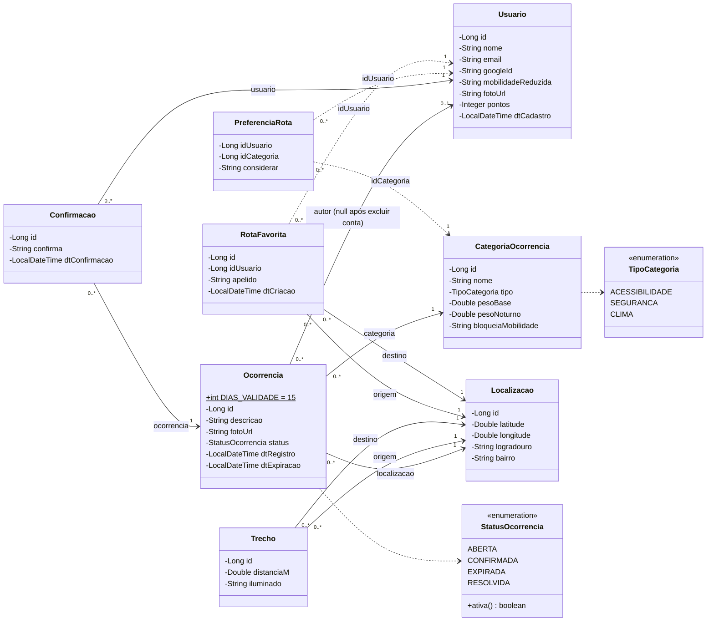

# Diagrama de classes — Caminho Livre API

Gerado a partir do código em `src/main/java/br/com/caminholivre`. O GitHub desenha os diagramas abaixo; para o PDF, cole cada bloco em [mermaid.live](https://mermaid.live) e exporte como PNG.

## Camada model (entidades JPA = tabelas do Oracle)

## Camadas controller → service → repository

Cada controller chama só services; cada service usa os repositories (Spring Data JPA, o "DAO") e concentra as regras de negócio (o "BO").

```mermaid
classDiagram
    direction TB

    class AuthController { +entrar(LoginRequest) }
    class OcorrenciaController { +listar() +criar() +detalhar() +atualizar() +excluir() +avaliar() }
    class UsuarioController { +listar() +buscar() +atualizar() +excluir() +preferencias() +salvarPreferencias() +ocorrencias() }
    class TrechoController { +listar() +pesos() +buscar() +criar() +atualizar() +excluir() }
    class RotaController { +calcular() }
    class RankingController { +bairros() +usuarios() }
    class RotaFavoritaController { +listar() +criar() +excluir() }
    class CategoriaController { CRUD }
    class LocalizacaoController { CRUD }

    class AuthService {
        +verificar(idToken) Payload
        +entrar(idToken) UsuarioResponse
        +usuarioDoToken(idToken) Optional~Usuario~
        +exigir(Usuario)$ Usuario
        +exigirProprio(Usuario, Long)$ Usuario
    }
    class OcorrenciaService {
        +criar(Usuario, NovaOcorrenciaRequest) OcorrenciaDetalhe
        +listar(tipo, status, bairro) List~OcorrenciaResumo~
        +detalhar(id, Usuario) OcorrenciaDetalhe
        +listarDoUsuario(idUsuario, Usuario) List~OcorrenciaDetalhe~
        +atualizar(id, NovaOcorrenciaRequest, Usuario) OcorrenciaDetalhe
        +excluir(id, Usuario)
    }
    class ConfirmacaoService { +avaliar(Usuario, idOcorrencia, confirma) TotaisResponse }
    class TrechoService {
        +calcularPesos(hora, mobilidadeReduzida, ignorar) List~TrechoPeso~
        +distanciaM(lat1, lon1, lat2, lon2)$ double
    }
    class RotaService { +calcular(origem, destino, hora, mobilidadeReduzida, ignorar) RotaResponse }
    class UsuarioService { +listar() +buscar() +atualizar() +excluir(id, Usuario) }
    class PreferenciaService { +listar(idUsuario, Usuario) +salvar(idUsuario, List, Usuario) }
    class RankingService { +bairros() RankingBairros +usuarios() List~PessoaRanking~ }
    class RotaFavoritaService { +listar(Usuario) +criar(Usuario, RotaFavoritaRequest) +excluir(id, Usuario) }
    class CategoriaService { CRUD }
    class LocalizacaoService { CRUD }
    class ExpiracaoJob { +expirar() «@Scheduled 3h» }

    AuthController --> AuthService
    OcorrenciaController --> OcorrenciaService
    OcorrenciaController --> ConfirmacaoService
    UsuarioController --> UsuarioService
    UsuarioController --> PreferenciaService
    UsuarioController --> OcorrenciaService
    TrechoController --> TrechoService
    RotaController --> RotaService
    RankingController --> RankingService
    RotaFavoritaController --> RotaFavoritaService
    CategoriaController --> CategoriaService
    LocalizacaoController --> LocalizacaoService
    RotaService --> TrechoService
    OcorrenciaService --> CategoriaService
    PreferenciaService --> CategoriaService
    TrechoService --> LocalizacaoService
    RotaFavoritaService --> LocalizacaoService

    class UsuarioRepository { <<JpaRepository>> }
    class OcorrenciaRepository { <<JpaRepository>> }
    class ConfirmacaoRepository { <<JpaRepository>> }
    class TrechoRepository { <<JpaRepository>> }
    class PreferenciaRotaRepository { <<JpaRepository>> }
    class RotaFavoritaRepository { <<JpaRepository>> }
    class CategoriaRepository { <<JpaRepository>> }
    class LocalizacaoRepository { <<JpaRepository>> }

    AuthService --> UsuarioRepository
    OcorrenciaService --> OcorrenciaRepository
    OcorrenciaService --> ConfirmacaoRepository
    OcorrenciaService --> UsuarioRepository
    OcorrenciaService --> LocalizacaoRepository
    ConfirmacaoService --> OcorrenciaRepository
    ConfirmacaoService --> ConfirmacaoRepository
    ConfirmacaoService --> UsuarioRepository
    TrechoService --> TrechoRepository
    TrechoService --> OcorrenciaRepository
    UsuarioService --> UsuarioRepository
    UsuarioService --> OcorrenciaRepository
    UsuarioService --> ConfirmacaoRepository
    UsuarioService --> PreferenciaRotaRepository
    UsuarioService --> RotaFavoritaRepository
    PreferenciaService --> PreferenciaRotaRepository
    RankingService --> OcorrenciaRepository
    RankingService --> UsuarioRepository
    RankingService --> LocalizacaoRepository
    RotaFavoritaService --> RotaFavoritaRepository
    CategoriaService --> CategoriaRepository
    LocalizacaoService --> LocalizacaoRepository
    ExpiracaoJob --> OcorrenciaRepository
```

Exceções (`exception/`): `RecursoNaoEncontradoException` (404), `RegraNegocioException` (422), `ConflitoException` (409), `NaoAutorizadoException` (401), `AcessoNegadoException` (403), tratadas pelo `GlobalExceptionHandler` (`@RestControllerAdvice`), que responde `{ timestamp, status, erro }`.
