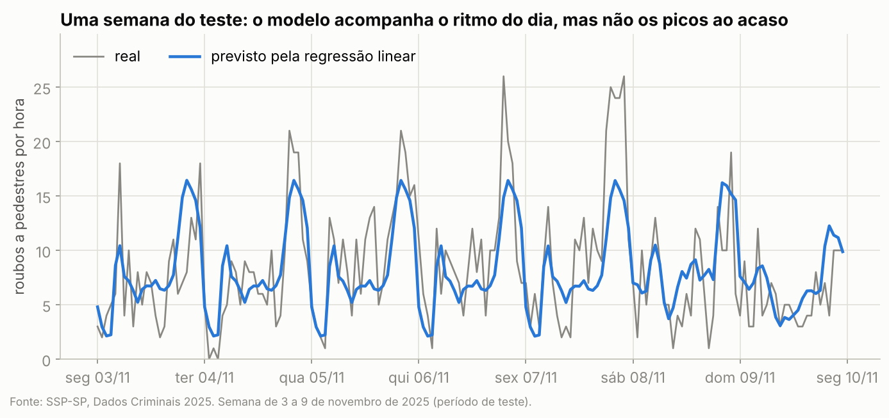
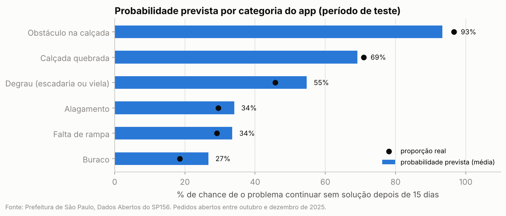

# 📊 Data Science & Statistical Computing — Dudu

**Disciplina:** Data Science & Statistical Computing · **Entrega:** ZIP no Teams até 19/11, às 23h55 (um envio por equipe)

## Conceito
Aplicar **regressão linear e logística** a dados públicos ligados ao problema do Caminho Livre e usar as previsões para fundamentar **recomendações de ações** que beneficiem o cidadão. **Entrega isolada**, sem conexão com o app.

## Entregáveis
- [x] Notebook executado com preparação dos dados, divisão entre treino e teste, os dois modelos, métricas, visualizações e recomendações → [`analise.ipynb`](analise.ipynb)
- [x] Base em CSV com indicação da fonte → [`dados/`](dados/) e [`dados/README.md`](dados/README.md)
- [x] TXT com nomes e RMs dos integrantes → [`integrantes.txt`](integrantes.txt)
- [x] ZIP pronto para o Teams → `python gerar_zip_entrega.py` (ver abaixo)

## Critérios de avaliação: onde está cada um
| Critério | Peso | Onde está no notebook |
|---|---|---|
| Contexto, perguntas e definição das variáveis-alvo | 1,0 | Seção 1 |
| Preparação dos dados e separação entre treino e teste, sem vazamento de dados | 2,0 | Seção 4 (4.1 SSP, 4.2 SP156, 4.3 separação e cuidados contra vazamento) |
| Regressão linear: implementação, MAE, RMSE, R² e interpretação | 2,0 | Seção 5 |
| Regressão logística: implementação, matriz de confusão, precisão, recall e F1 | 2,0 | Seção 6 |
| Recomendações de ações fundamentadas nas previsões, com limitações e impactos | 3,0 | Seção 7 e [`conclusao.md`](conclusao.md) |

## Perguntas, variáveis-alvo e resultados
Treino: janeiro a setembro de 2025. Teste: outubro a dezembro de 2025 (separação **temporal**, para o modelo nunca ver o futuro).

| Pergunta | Modelo | Variável-alvo | Resultado no teste |
|---|---|---|---|
| **P1.** Quantos roubos a pedestres esperar em cada hora do dia? | Regressão linear | `roubos`: roubos a pedestres na cidade naquela hora (SSP-SP) | **MAE 2,84 · RMSE 3,75 · R² 0,48** (prever a média: R² −0,04) |
| **P2.** Um problema na rua ainda estará sem solução depois de 15 dias? | Regressão logística | `persiste_15d`: 1 se o pedido ao SP156 não foi finalizado em 15 dias | **precisão 0,66 · recall 0,45 · F1 0,53** · AUC 0,72 (marcar tudo como "persiste": F1 0,43) |





## Recomendações (resumo)
1. **Peso de risco por hora nas rotas:** o risco previsto de roubo vai de 0,26 (2h) a 2,04 (20h) vezes a média.
2. **"Noite" pelo anoitecer real**, e não pela janela fixa das 19h às 6h: uma hora toda escura tem +1,7 roubo (+15% às 18h).
3. **Validade de 90 dias, com confirmação**, para alertas de obstáculo (93% de chance de persistir), calçada quebrada (69%) e degrau (55%); 15 dias para os demais.
4. **Lembrete de confirmação no 15º dia** para alertas com alta chance de persistir.
5. **Relatório por subprefeitura** dos alertas de acessibilidade que tendem a demorar.

Limitações e impactos de cada uma estão na seção 7 do notebook e em [`conclusao.md`](conclusao.md).

## Como executar
Na pasta `data-science/`:

```bash
pip install -r requirements.txt
```

```bash
jupyter notebook analise.ipynb
```

O notebook roda em menos de 1 minuto, usando as bases que já estão em `dados/`.

## Como montar o ZIP de entrega
```bash
python gerar_zip_entrega.py
```

Gera `entrega/GS2026-2_DataScience_OctoFlow_CaminhoLivre.zip` (~13 MB) com: o notebook executado, `integrantes.txt`, as duas bases em **CSV comum** (abrem no Excel), `dados/README.md` com as fontes, a conclusão e os gráficos. O notebook roda a partir da pasta descompactada.

## Estrutura
```
data-science/
├── analise.ipynb           notebook executado (contexto, preparo, 2 modelos, métricas, recomendações)
├── conclusao.md            conclusão: resultados, recomendações, limitações e impactos
├── integrantes.txt         nomes e RMs
├── gerar_zip_entrega.py    monta o ZIP para o Teams
├── requirements.txt        bibliotecas Python
├── dados/
│   ├── README.md           fontes, versões (SHA-256), dicionário e problemas de qualidade
│   ├── ssp_roubos_furtos_capital_2025.csv.gz
│   ├── sp156_rua_e_bairro_2025.csv.gz
│   ├── funil_extracao.csv
│   ├── baixar_dados.py     baixa os arquivos oficiais para dados/brutos/ (ignorada pelo git)
│   └── gerar_extratos.py   recorte + anonimização → extratos acima
└── graficos/               8 gráficos em PNG (gerados pelo notebook)
```

## Fontes de dados
- **SSP-SP**, Consultas – Base de Dados – *Dados criminais 2025* ([ssp.sp.gov.br/estatistica/consultas](https://www.ssp.sp.gov.br/estatistica/consultas)), versão de 30/06/2026.
- **Prefeitura de São Paulo**, Portal de Dados Abertos – *Dados do SP156 – Solicitações*, 4 trimestres de 2025 ([dados.prefeitura.sp.gov.br/dataset/dados-do-sp156](https://dados.prefeitura.sp.gov.br/dataset/dados-do-sp156)), licença CC0.

> Nada de dados pessoais: as bases não têm número de BO (trocado por um código pseudônimo), endereço, número nem CEP, e as coordenadas foram arredondadas para ~100 m.

## Escopo: entrega isolada
Esta análise **não se conecta ao app** (banco, API e rota não dependem dela). Ela usa o mesmo tema do Caminho Livre e, nas recomendações, descreve como as previsões **poderiam** calibrar a solução no futuro.
