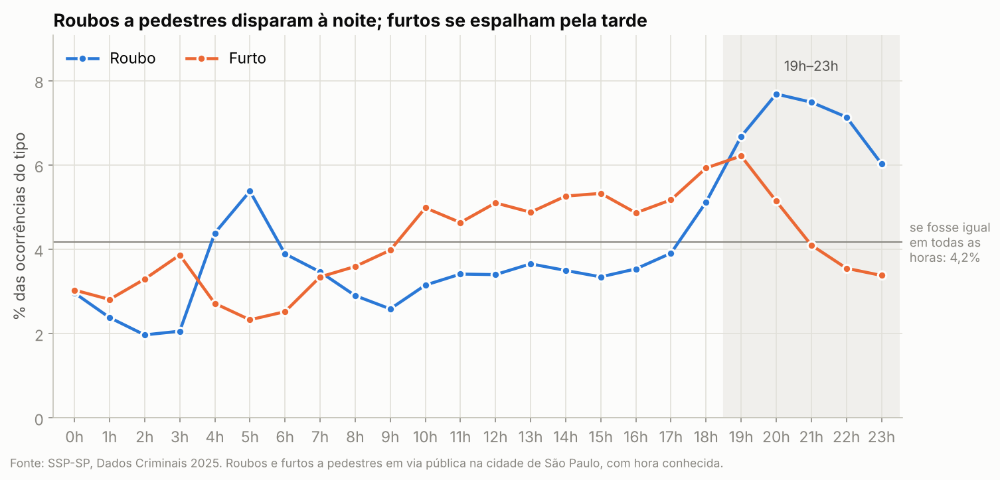
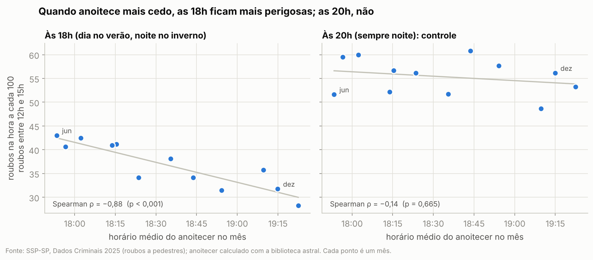

# 📊 Data Science & Statistical Computing — Dudu

**Disciplina:** Data Science & Statistical Computing · **Entrega:** arquivos e links no Teams até 19/11, 23h55

## Conceito
Usar dados reais ligados ao tema do Caminho Livre para **testar hipóteses** sobre segurança e acessibilidade de pedestres. **Entrega isolada**, sem conexão com o app.

## Entregáveis
- [x] Base de dados + **fonte** citada → [`dados/`](dados/) e [`dados/README.md`](dados/README.md)
- [x] Notebook → [`analise.ipynb`](analise.ipynb) (já executado, com todas as saídas)
- [x] Visualizações → [`graficos/`](graficos/)
- [x] Conclusão curta: resultados, limitações e possível uso futuro na solução → [`conclusao.md`](conclusao.md)

## Avaliação
| Critério | Peso | Onde está |
|---|---|---|
| Dados e preparo | 3 | Duas bases oficiais (SSP-SP e SP156), fontes e versões em [`dados/README.md`](dados/README.md); preparo passo a passo nas seções A.1 e B.1 do notebook |
| Método | 3 | Qui-quadrado (aderência e independência), teste binomial com IC de Wilson, razão de chances, Spearman, bootstrap e experimento natural com o pôr do sol (A.3 a A.6, B.2 e B.3) |
| Análise e interpretação | 3 | Interpretação após cada teste, checagens de robustez (A.4) e [`conclusao.md`](conclusao.md) |
| Clareza | 1 | Resumo no topo do notebook, 7 gráficos com título explicativo e código comentado |

## Hipóteses
| # | Hipótese | Base | Resultado |
|---|---|---|---|
| H1 | Roubos e furtos a pedestres concentram-se entre 19h e 23h | SSP-SP, Dados Criminais 2025 | **Confirmada para roubo** (35,0% contra 20,8% esperados, 1,68 vez; p < 0,001). **Fraca para furto** (22,4%, 1,07 vez) |
| H2 | Ruas com reclamação de iluminação têm mais ocorrências criminais | SP156 | **Não testável:** o SP156 de 2025 não tem categoria de iluminação. No lugar, um experimento natural com o pôr do sol mostra que **a escuridão aumenta o risco de roubo** (seção A.5) |
| H3 | Algumas regiões concentram reclamações de calçada | SP156 2025 | **Confirmada:** a fatia de pedidos de calçada varia **3,6 vezes** entre subprefeituras (p < 0,001), mais alta nas centrais |

## Resultados em 1 minuto



* **Roubo é noturno; furto, não.** 35% dos roubos a pedestres acontecem entre 19h e 23h. Há um segundo pico entre 4h e 6h, de quem sai cedo para trabalhar.
* **A escuridão pesa, não só o relógio.** Às 18h há mais roubos nos dias em que já escureceu (razão de chances 1,22). Às 20h, sempre escuro, não há diferença.
* **Peso noturno de ~1,4.** Por hora, o risco de roubo no escuro é 1,43 vez o do dia (IC 95%: 1,40 a 1,45).
* **Calçada demora a ser consertada.** Só 6% dos pedidos de obstáculo na calçada são resolvidos em 15 dias, que é a validade de um alerta sem confirmação no app (RF14).



## Possível uso futuro no Caminho Livre
Detalhes em [`conclusao.md`](conclusao.md):
1. `peso_noturno` do alerta "Assalto" de pelo menos **1,4 ×** `peso_base` (ou um índice por hora);
2. "noite" definida pelo **pôr do sol de cada dia**, e não pela janela fixa 19h–6h;
3. **validade maior** para alertas de acessibilidade (calçada quebrada, obstáculo) do que os 15 dias atuais;
4. ranking de bairros (US14) comparando regiões pelo número de usuários ativos, para corrigir o viés de "quem reclama mais".

## Como executar
Na pasta `data-science/`:

```bash
pip install -r requirements.txt
```

```bash
jupyter notebook analise.ipynb
```

O notebook usa os extratos que já estão em `dados/` e roda em menos de 1 minuto. Para refazer os extratos a partir dos arquivos oficiais (~680 MB):

```bash
python dados/baixar_dados.py
```

```bash
python dados/gerar_extratos.py
```

## Estrutura
```
data-science/
├── analise.ipynb          notebook principal (preparo, testes, gráficos e conclusão)
├── conclusao.md           conclusão curta: resultados, limitações e uso possível no app
├── requirements.txt       bibliotecas Python
├── dados/
│   ├── README.md          fontes, versões (SHA-256), dicionário e problemas de qualidade
│   ├── baixar_dados.py    baixa os arquivos oficiais para dados/brutos/ (ignorada pelo git)
│   ├── gerar_extratos.py  recorte + anonimização → extratos abaixo
│   ├── ssp_roubos_furtos_capital_2025.csv.gz
│   ├── sp156_rua_e_bairro_2025.csv.gz
│   └── funil_extracao.csv
└── graficos/              7 gráficos em PNG (gerados pelo notebook)
```

## Fontes de dados
- **SSP-SP**, Consultas – Base de Dados – *Dados criminais 2025* ([ssp.sp.gov.br/estatistica/consultas](https://www.ssp.sp.gov.br/estatistica/consultas)), versão de 30/06/2026.
- **Prefeitura de São Paulo**, Portal de Dados Abertos – *Dados do SP156 – Solicitações*, 4 trimestres de 2025 ([dados.prefeitura.sp.gov.br/dataset/dados-do-sp156](https://dados.prefeitura.sp.gov.br/dataset/dados-do-sp156)), licença CC0.

> Nada de dados pessoais: os extratos não têm número de BO (trocado por um código pseudônimo), endereço, número nem CEP, e as coordenadas foram arredondadas para ~100 m.

## Escopo: entrega isolada
Esta análise **não se conecta ao app** (banco, API e rota não dependem dela). Ela usa o mesmo tema do Caminho Livre e, na conclusão, descreve como **poderia** apoiar a solução no futuro, por exemplo calibrando os pesos de risco por horário.
