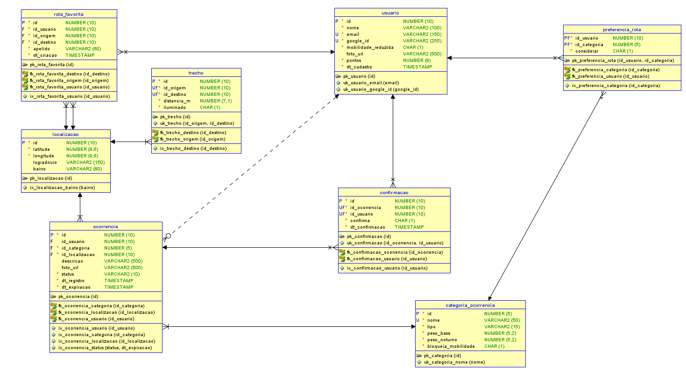
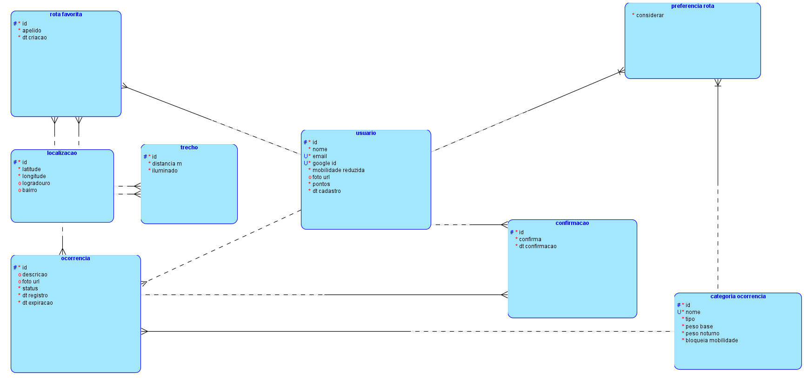

  

Caminho Livre

O mapa da cidade que mostra o que o GPS não vê

 

DATABASE DESIGN

Global Solution 2026.2 — CitizenTech

  

**EQUIPE OCTOFLOW**

| Integrante                           |   RM   |
| :----------------------------------- | :----: |
| **Caio Nascimento Caminha**          | 564789 |
| **Eduardo Duran Del Ciel**           | 562017 |
| **Eduardo Ulisses Pereira da Silva** | 566339 |
| **Henrique Castro de Matos**         | 564560 |
| **Laura Tigre Amaral**               | 565281 |

 

|               |                                        |
| :------------ | :------------------------------------- |
| **Solução**   | Caminho Livre                          |
| **Turma**     | 2ESPV — Engenharia de Software, 2º ano |
| **Entrega**   | Global Solution 2026.2 — 19/11/2026    |

  

_FIAP — Faculdade de Informática e Administração Paulista_

Sumário

- [1. Objetivo e escopo do projeto](#1-objetivo-e-escopo-do-projeto)
- [2. Principais funcionalidades](#2-principais-funcionalidades)
- [3. Diagrama do modelo lógico](#3-diagrama-do-modelo-lógico)
- [4. Tabelas e relacionamentos](#4-tabelas-e-relacionamentos)
- [5. Scripts SQL entregues](#5-scripts-sql-entregues)

## 1. Objetivo e escopo do projeto

**Problema.** Quem anda a pé (pessoas com mobilidade reduzida, idosos, pais com carrinho de bebê e quem volta para casa à noite) não sabe, antes de sair, onde há degrau, calçada quebrada, rua escura ou alagamento. Os aplicativos de rota tratam toda calçada como transitável e toda rua como segura a qualquer hora.

**Solução.** O **Caminho Livre** é um aplicativo web colaborativo. O usuário entra com a conta Google e registra alertas com foto, categoria e local. A comunidade confirma ou nega cada alerta, e os que não são confirmados expiram em 15 dias. Com esses alertas, o app calcula uma **rota acessível** que desvia dos problemas e a mostra ao lado da rota comum.

**Objetivo do banco de dados.** Guardar, de forma consistente, as informações de que o Caminho Livre precisa para funcionar: usuários, categorias de alerta e seus pesos, localizações, alertas (ocorrências), confirmações da comunidade, preferências de rota, trechos de rua usados no cálculo da rota e rotas favoritas.

**Escopo.**

- **Dentro do escopo:** cadastro de usuários autenticados pelo Google (sem senha), registro e ciclo de vida dos alertas (`ABERTA` → `CONFIRMADA`, `RESOLVIDA` ou `EXPIRADA`), confirmações únicas por usuário, pesos por categoria e por período (dia e noite), grafo de trechos de rua, preferências de rota, rotas favoritas, pontuação dos usuários e exclusão de conta com anonimização (LGPD).
- **Fora do escopo:** painel de gestor, acompanhamento de trajeto em tempo real e conexão entre usuários.
- **Ambiente:** Oracle Database do servidor da FIAP. A API Java (Spring Boot) usa exatamente este modelo.
- **Dados:** todos os usuários da carga são fictícios. Os pontos geográficos são reais, no entorno da FIAP Paulista (Bela Vista e Jardim Paulista).

## 2. Principais funcionalidades

| Funcionalidade | Como o banco atende |
| :-- | :-- |
| **Entrar com Google** | `USUARIO` guarda nome, e-mail e o identificador do Google, com e-mail e `google_id` únicos. Nenhuma senha é armazenada. |
| **Enviar alerta** | `OCORRENCIA` liga o autor, a categoria e a localização. A validade de 15 dias é preenchida por trigger. |
| **Ver alertas no mapa** | Consulta das ocorrências com status `ABERTA` ou `CONFIRMADA`, filtradas por tipo de categoria e por bairro. |
| **Confirmar ou negar um alerta** | `CONFIRMACAO` aceita um voto por usuário por alerta (`UNIQUE`). Uma trigger impede que o autor avalie o próprio alerta. |
| **Expirar alertas antigos** | `dt_expiracao` mais o status permitem mudar para `EXPIRADA` os alertas vencidos e não confirmados. |
| **Rota acessível** | `TRECHO` forma o grafo de ruas entre `LOCALIZACAO`. Os pesos (`peso_base`, `peso_noturno`) e o bloqueio para mobilidade reduzida vêm de `CATEGORIA_OCORRENCIA`. |
| **Personalizar a rota** | `PREFERENCIA_ROTA` indica quais categorias cada usuário quer considerar. |
| **Ranking de bairros** | Agrupamento das ocorrências ativas por bairro de `LOCALIZACAO`. |
| **Rotas favoritas e pontos** | `ROTA_FAVORITA` guarda origem, destino e apelido. `USUARIO.pontos` acumula +10 por alerta enviado e +2 por avaliação. |
| **Excluir a conta (LGPD)** | `ON DELETE SET NULL` mantém os alertas no mapa sem o autor. Confirmações, preferências e favoritas são apagadas em cascata. |

## 3. Diagrama do modelo lógico

### 3.1 Visão de entidades (Logical)

_Os dois diagramas foram feitos no **Oracle Data Modeler**. O relacional (3) mostra todas as tabelas, atributos e tipos, as chaves primárias (P), estrangeiras (F) e únicas (U), os relacionamentos e as cardinalidades. No relacional, a linha tracejada com círculo marca a única FK que aceita nulo: o autor da ocorrência, que fica nulo depois da exclusão da conta. A visão de entidades (3.1) mostra a mesma estrutura com `#` = identificador, `*` = obrigatório, `o` = opcional e `U` = único. Em cada linha, a metade tracejada marca o lado opcional (um usuário pode não ter nenhum alerta, por exemplo), a metade cheia marca o lado obrigatório e o pé de galinha marca o lado N. A ligação entre usuário e ocorrência é toda tracejada pelo mesmo motivo do autor nulo._

## 4. Tabelas e relacionamentos

| Tabela | Chave primária | Chaves estrangeiras | Descrição |
| :-- | :-- | :-- | :-- |
| `USUARIO` | `id` | — | Pessoa que usa o app (login Google) |
| `CATEGORIA_OCORRENCIA` | `id` | — | Tipo de problema, com pesos de dia e de noite |
| `LOCALIZACAO` | `id` | — | Ponto geográfico: local de um alerta ou vértice do grafo |
| `OCORRENCIA` | `id` | `id_usuario`, `id_categoria`, `id_localizacao` | Alerta enviado por um usuário |
| `CONFIRMACAO` | `id` | `id_ocorrencia`, `id_usuario` | Voto 👍/👎 de um usuário sobre um alerta |
| `PREFERENCIA_ROTA` | (`id_usuario`, `id_categoria`) | `id_usuario`, `id_categoria` | Categorias que o usuário considera na rota |
| `TRECHO` | `id` | `id_origem`, `id_destino` | Segmento de rua entre duas localizações |
| `ROTA_FAVORITA` | `id` | `id_usuario`, `id_origem`, `id_destino` | Rota salva pelo usuário |

| Relacionamento | Cardinalidade |
| :-- | :-- |
| `USUARIO` envia `OCORRENCIA` | 1 : N (opcional do lado do usuário: o autor fica nulo após a exclusão da conta) |
| `CATEGORIA_OCORRENCIA` classifica `OCORRENCIA` | 1 : N |
| `LOCALIZACAO` situa `OCORRENCIA` | 1 : N |
| `OCORRENCIA` recebe `CONFIRMACAO` | 1 : N |
| `USUARIO` faz `CONFIRMACAO` | 1 : N |
| `USUARIO` × `CATEGORIA_OCORRENCIA` (via `PREFERENCIA_ROTA`) | N : N |
| `LOCALIZACAO` é origem / destino de `TRECHO` | 1 : N (duas vezes) |
| `USUARIO` salva `ROTA_FAVORITA` | 1 : N |
| `LOCALIZACAO` é origem / destino de `ROTA_FAVORITA` | 1 : N (duas vezes) |

**Normalização.** O modelo está na **3ª forma normal**. Todos os atributos são atômicos (latitude e longitude ficam em colunas separadas). Na única chave composta (`PREFERENCIA_ROTA`), `considerar` depende da chave inteira. Os dados que dependem da categoria (tipo, pesos e bloqueio) ficam só em `CATEGORIA_OCORRENCIA`, e endereço e bairro ficam só em `LOCALIZACAO`.

**Integridade.** Todas as constraints têm nome: `PK`, `FK`, `UNIQUE` (e-mail, `google_id`, um voto por usuário por alerta, trecho único entre dois pontos), `CHECK` (status, tipo, `S`/`N`, latitude e longitude válidas, pesos e distância positivos, origem diferente do destino) e `DEFAULT`. Há também duas triggers: a validade de 15 dias e o bloqueio da avaliação do próprio alerta.

## 5. Scripts SQL entregues

Os scripts vão em arquivos `.sql` separados e devem ser executados nesta ordem no Oracle da FIAP:

| Arquivo | Tipo | Conteúdo |
| :-- | :-- | :-- |
| `01_create.sql` | **DDL** | `CREATE TABLE` das 8 tabelas com PK, UNIQUE e CHECK, `ALTER TABLE` com as 12 FKs, índices, as 2 triggers e comentários. Pode ser executado de novo, porque apaga e recria tudo. |
| `02_insert.sql` | **DML** | Carga com no mínimo 5 linhas por tabela (entre 6 e 16 linhas). |
| `03_consultas.sql` | **DQL** | **A1** INNER JOIN entre 2 tabelas · **A2** INNER JOIN entre 2 tabelas com `GROUP BY` · **A3** LEFT OUTER JOIN entre 2 tabelas com `WHERE` e `ORDER BY`, seguidas de consultas complementares usadas pelo app. |

 

---

**Caminho Livre** · Equipe OctoFlow 
Global Solution FIAP 2026.2

