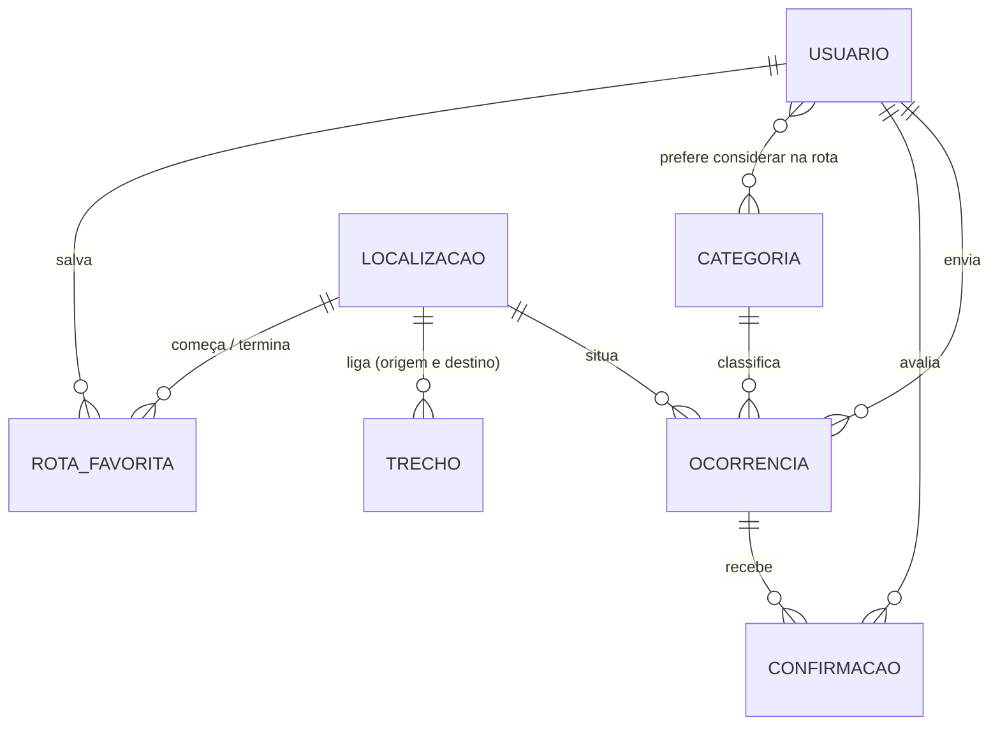
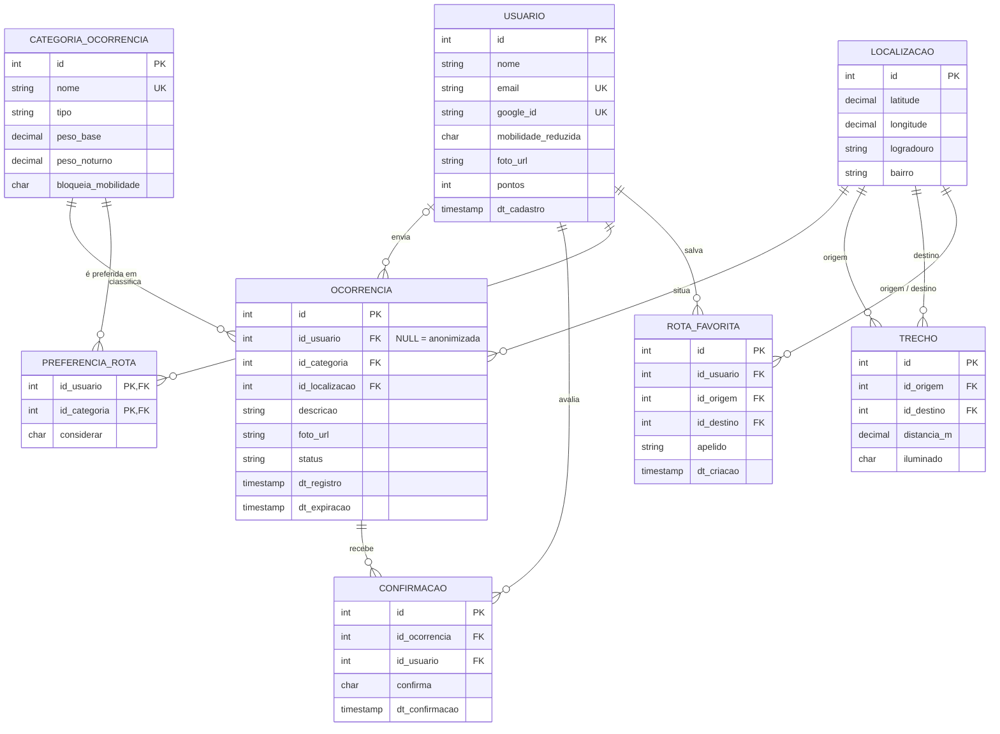
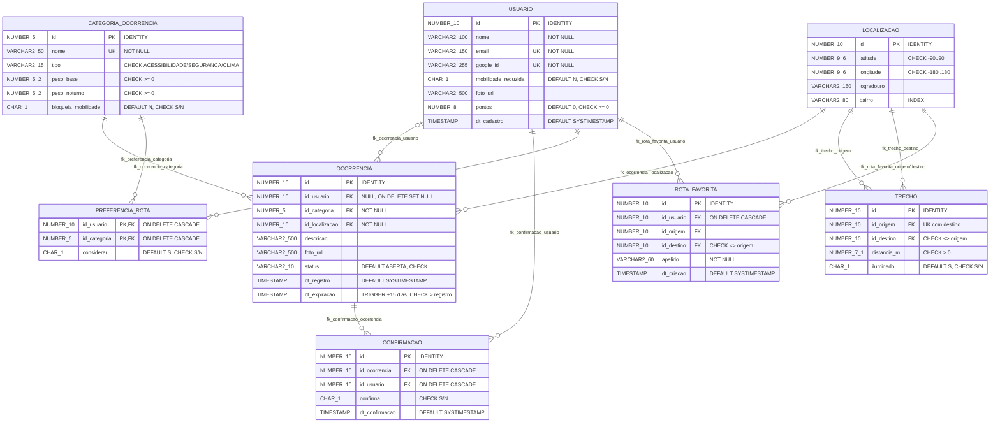

# Modelos — Caminho Livre

Os diagramas abaixo estão em [Mermaid](https://mermaid.js.org/) e aparecem desenhados no GitHub. As imagens `conceitual.png`, `logico.png` e `fisico.png` desta pasta são exportadas deles. Detalhe de cada coluna: [dicionário de dados](../dicionario-dados.md).

## 1. Modelo conceitual

Entidades e relacionamentos, sem atributos técnicos.

## 2. Modelo lógico

Atributos, chaves e cardinalidades; o N:N de preferências vira a entidade associativa `PREFERENCIA_ROTA`.

## 3. Modelo físico (Oracle)

Tipos Oracle, nulidade e constraints, como em [`01_create.sql`](../scripts/01_create.sql).

Triggers do físico: `trg_ocorrencia_expiracao` (validade de 15 dias) e `trg_confirmacao_autor` (autor não avalia o próprio alerta).
