# Network Architect Solutions — Relatório da rede do Posto Caminho Livre

**Global Solution 2026.2 · CitizenTech · FIAP · Engenharia de Software · 2ESPV**

| Grupo OctoFlow | RM |
|---|---|
| Henrique Castro de Matos | 564560 |
| Caio Nascimento Caminha | 564789 |
| Eduardo Ulisses Pereira da Silva | 566339 |
| Eduardo Duran Del Ciel | 562017 |
| Laura Tigre Amaral | 565281 |

**Arquivo do simulador:** `caminho-livre-rede.pkt` (Cisco Packet Tracer 9.0.1)

**Vídeo dos serviços funcionando:** https://youtu.be/jQe6hr3nbCQ

---

## 1. A CitizenTech

O **Caminho Livre** é um mapa colaborativo em que pedestres avisam onde há degrau, calçada quebrada, rua escura ou alagamento. A comunidade confirma os alertas, e o app sugere uma rota acessível que desvia deles. O público principal são pessoas com mobilidade reduzida e quem volta a pé à noite. A Ficha completa está no `README.md` do repositório e na página do servidor do posto.

## 2. Cenário da rede

A rede atende o **Posto Caminho Livre**, uma base comunitária no entorno da FIAP Paulista (Bela Vista, São Paulo). O posto tem três tipos de uso:

| Usuários | O que precisam | Restrição |
|---|---|---|
| **Equipe do posto** (voluntários do coletivo de bairro) | Computadores, e-mail interno e acesso aos servidores | Precisa ficar isolada do público |
| **Cidadão** (qualquer pessoa que passe pelo posto) | Wi-Fi para abrir o app, registrar alertas e ver a página do posto | Rede aberta ao público, não confiável |
| **Servidores do posto** | DNS, página do posto e e-mail da equipe | Só os serviços necessários podem ser expostos |

O app do Caminho Livre roda na nuvem. Por isso o posto depende de **um link com o provedor**, aqui simulado por um link serial entre o roteador do posto e o roteador do provedor, com um servidor na nuvem do outro lado.

## 3. Topologia

<div class="topo">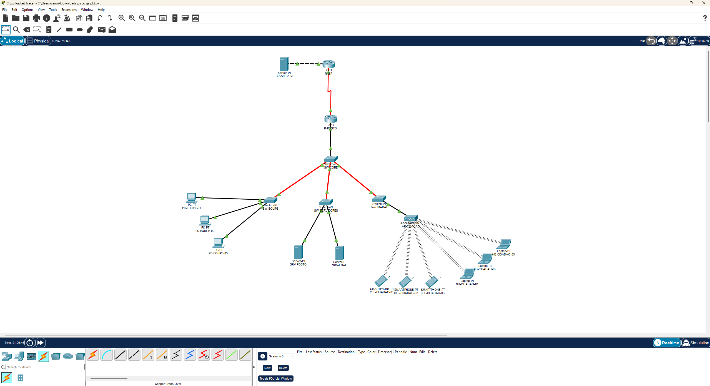</div>

```
                    SRV-NUVEM 198.51.100.10 (app Caminho Livre)
                              | UTP
                        G0/0 198.51.100.1
                        +-----------+
                        |   R-ISP   |  roteador do provedor
                        +-----------+
                        Se0/0/0 203.0.113.1 (DCE)
                              | serial PPP/CHAP - 203.0.113.0/30
                        Se0/0/0 203.0.113.2
                        +-----------+
                        |  R-POSTO  |  inter-VLAN, DHCP, NAT/PAT, ACL, SSH
                        +-----------+
                        G0/0 trunk 802.1Q (.10 .20 .30 .99)
                              | UTP
                        +-----------+
                        |  SW-CORE  |
                        +-----------+
           fibra Gi1/1 /      | fibra Gi2/1   \ fibra Gi3/1
      +-----------+   +---------------+   +------------+
      | SW-EQUIPE |   | SW-SERVIDORES |   | SW-CIDADAO |
      +-----------+   +---------------+   +------------+
        UTP | VLAN 10     UTP | VLAN 30      UTP | VLAN 20
   PC-EQUIPE-01/02/03   SRV-POSTO .162     AP-CIDADAO (WPA2)
                        SRV-EMAIL .163      ))) NB-CIDADAO-01/02/03
                                            ))) CEL-CIDADAO-01/02/03
```

A rede segue um modelo hierárquico de dois níveis. O **SW-CORE** concentra os uplinks de fibra e o trunk com o roteador. Os **switches de acesso** separam fisicamente cada setor. Cada setor tem a sua VLAN, e o tráfego entre setores sempre passa pelo R-POSTO, onde ficam as regras de segurança.

## 4. Atendimento aos requisitos mínimos

| Requisito do enunciado | Como foi atendido |
|---|---|
| 2 roteadores com conexão serial | R-POSTO e R-ISP (2911 com módulo HWIC-2T), ligados por cabo serial com PPP/CHAP |
| 4 switches com módulo de fibra óptica | SW-CORE (3 módulos PT-SWITCH-NM-1FGE) e SW-EQUIPE, SW-SERVIDORES e SW-CIDADAO (1 módulo cada) |
| 3 PCs | PC-EQUIPE-01, 02 e 03 |
| 3 servidores | SRV-POSTO, SRV-EMAIL e SRV-NUVEM |
| 3 laptops com placa wireless | NB-CIDADAO-01, 02 e 03 com placa WPC300N |
| 3 smartphones via wireless | CEL-CIDADAO-01, 02 e 03 |
| 1 Access Point (não roteador wireless) | AP-CIDADAO (AccessPoint-PT) |
| Cabos UTP, fibra e wireless | UTP nos dispositivos e no trunk do roteador; fibra entre os switches; wireless no Wi-Fi público (e serial entre os roteadores) |
| Página web personalizada em todos os servidores | Ficha da CitizenTech (SRV-POSTO), página do e-mail da equipe (SRV-EMAIL) e página do app (SRV-NUVEM) |
| E-mail enviado de um dispositivo para outro | PC-EQUIPE-01 envia para PC-EQUIPE-02 pelo SRV-EMAIL |
| DHCP funcionando | R-POSTO com um pool para a Equipe e outro para o Wi-Fi do cidadão |
| VLANs | 10 Equipe, 20 Cidadão, 30 Servidores, 99 Gerência e 999 nativa sem uso |
| Roteamento configurado | Inter-VLAN por router-on-a-stick e rota padrão do posto para o provedor |

## 5. Plano de endereçamento

A rede interna usa a faixa privada `192.168.10.0/24`, dividida com **VLSM** da maior demanda para a menor:

| VLAN | Setor | Hosts necessários | Sub-rede | Máscara | Faixa útil | Gateway | Broadcast |
|---|---|---|---|---|---|---|---|
| 20 | Cidadão (Wi-Fi público) | até 120 | 192.168.10.0/25 | 255.255.255.128 | .1 a .126 | 192.168.10.1 | 192.168.10.127 |
| 10 | Equipe | até 30 | 192.168.10.128/27 | 255.255.255.224 | .129 a .158 | 192.168.10.129 | 192.168.10.159 |
| 30 | Servidores | até 30 | 192.168.10.160/27 | 255.255.255.224 | .161 a .190 | 192.168.10.161 | 192.168.10.191 |
| 99 | Gerência dos switches | até 14 | 192.168.10.192/28 | 255.255.255.240 | .193 a .206 | 192.168.10.193 | 192.168.10.207 |
| — | Reserva para expansão | — | 192.168.10.208/28 e 192.168.10.224/27 | — | — | — | — |

**Cálculo:** o Wi-Fi público é o setor com mais dispositivos (qualquer pessoa que passe pelo posto), então recebe metade da faixa: um /25 com 2⁷ − 2 = 126 hosts. Equipe e servidores precisam de poucos endereços: um /27 com 2⁵ − 2 = 30 hosts cada. A gerência dos 4 switches cabe num /28 com 2⁴ − 2 = 14 hosts. Os blocos `.208/28` e `.224/27` ficam livres para um novo setor (por exemplo, câmeras ou sensores de iluminação).

### Redes externas

| Link | Rede | Endereços |
|---|---|---|
| Serial R-POSTO ↔ R-ISP | 203.0.113.0/30 | R-ISP .1 · R-POSTO .2 |
| Nuvem | 198.51.100.0/24 | R-ISP .1 · SRV-NUVEM .10 |

As duas usam faixas reservadas para documentação (RFC 5737), para não colidir com endereços reais. O /30 deixa exatamente 2 hosts, o necessário para um link ponto a ponto.

### Endereços fixos

| Equipamento | Interface | Endereço | Gateway |
|---|---|---|---|
| R-POSTO | G0/0.10 · G0/0.20 · G0/0.30 · G0/0.99 | .129/27 · .1/25 · .161/27 · .193/28 | — |
| R-POSTO | Se0/0/0 | 203.0.113.2/30 | rota padrão para 203.0.113.1 |
| R-ISP | Se0/0/0 · G0/0 | 203.0.113.1/30 · 198.51.100.1/24 | — |
| SRV-POSTO | Fa0 | 192.168.10.162/27 | 192.168.10.161 |
| SRV-EMAIL | Fa0 | 192.168.10.163/27 | 192.168.10.161 |
| SRV-NUVEM | Fa0 | 198.51.100.10/24 | 198.51.100.1 |
| SW-CORE · SW-EQUIPE · SW-SERVIDORES · SW-CIDADAO | Vlan99 | .194 · .195 · .196 · .197 (/28) | 192.168.10.193 |
| PCs, laptops e smartphones | — | DHCP | entregue pelo DHCP |

## 6. Serviços implementados

### 6.1 VLANs e trunks
Cada setor tem a sua VLAN. Os links entre switches e o link com o roteador são **trunks 802.1Q** que levam só as VLANs necessárias: o trunk para o SW-EQUIPE leva as VLANs 10 e 99, o do SW-SERVIDORES leva 30 e 99, e o do SW-CIDADAO leva 20 e 99. A VLAN nativa foi trocada para a 999, que não tem nenhum dispositivo. Isso evita que um quadro sem marcação caia numa VLAN real.

### 6.2 Roteamento
- **Inter-VLAN (router-on-a-stick):** a G0/0 do R-POSTO tem uma subinterface por VLAN, cada uma com o gateway da sua sub-rede.
- **Saída para o provedor:** rota padrão estática `0.0.0.0/0` para 203.0.113.1. O posto tem um único link de saída, então uma rota estática é mais simples e previsível que um protocolo dinâmico.
- **Link serial:** encapsulamento PPP com autenticação CHAP. O R-ISP fica no lado DCE e define o clock (64 kbps).

### 6.3 DHCP
O R-POSTO distribui endereços para a Equipe (pool `EQUIPE`) e para o Wi-Fi do cidadão (pool `CIDADAO`), entregando gateway e DNS. Os gateways e uma faixa reservada para equipamentos fixos ficam fora dos pools (`.1–.10` e `.129–.133`). Servidores e switches usam IP fixo, porque outros serviços dependem do endereço deles.

### 6.4 NAT/PAT
Toda a rede `192.168.10.0/24` sai para o provedor com o IP da serial (203.0.113.2), usando sobrecarga de portas (`overload`). O provedor não precisa conhecer as redes internas, e os endereços privados ficam escondidos.

### 6.5 DNS
O SRV-POSTO responde pela zona `caminholivre.lan`:

| Nome | Endereço | Serviço |
|---|---|---|
| www.caminholivre.lan | 192.168.10.162 | Página do posto com a Ficha |
| mail.caminholivre.lan | 192.168.10.163 | E-mail da equipe |
| app.caminholivre.lan | 198.51.100.10 | App na nuvem |

### 6.6 Web
Os três servidores têm páginas próprias: o SRV-POSTO mostra a Ficha da CitizenTech, o SRV-EMAIL explica o e-mail da equipe e o SRV-NUVEM simula o app Caminho Livre hospedado na nuvem.

### 6.7 E-mail
O SRV-EMAIL roda SMTP (envio) e POP3 (recebimento) no domínio `caminholivre.lan`, com as contas `equipe1`, `equipe2` e `equipe3`. Cada PC da equipe tem o cliente de e-mail configurado com o servidor `mail.caminholivre.lan`.

### 6.8 Wi-Fi público
O AP-CIDADAO publica a rede `CaminhoLivre-Publico` com **WPA2-PSK (AES)**. Ele funciona como ponte (bridge) para a VLAN 20: quem roteia, entrega IP e aplica a ACL é o R-POSTO.

## 7. Segurança

| Medida | Onde | O que protege |
|---|---|---|
| ACL estendida `ACL_CIDADAO` | Entrada da G0/0.20 do R-POSTO | O Wi-Fi público só alcança o DHCP, o DNS e a página do SRV-POSTO, além da internet. Equipe, e-mail, gerência e o próprio roteador ficam bloqueados. |
| Só SSH v2 nos acessos remotos | VTY do R-POSTO | Sem Telnet: senha e comandos trafegam criptografados |
| ACL `10` na VTY | R-POSTO | SSH aceito só a partir das VLANs Equipe e Gerência |
| `login block-for 120 attempts 3 within 60` | R-POSTO | Bloqueia o login por 2 minutos após 3 erros em 1 minuto (força bruta) |
| `enable secret`, senha no console e `service password-encryption` | Todos os roteadores e switches | Nenhuma senha aparece em texto puro na configuração |
| VTY desativada (`transport input none`) | R-ISP | O roteador do provedor não aceita acesso remoto |
| PPP com CHAP | Link serial | O roteador só sobe o link com quem conhece a senha |
| WPA2-PSK com AES | AP-CIDADAO | Tráfego Wi-Fi criptografado |
| VLAN nativa 999, portas sem uso desligadas na VLAN 999, `Vlan1` desligada | Switches | Reduz VLAN hopping e impede ligar um equipamento numa porta livre |
| Servidores só com os serviços necessários | SRV-POSTO, SRV-EMAIL e SRV-NUVEM | Menos serviços expostos |

Regras da `ACL_CIDADAO`, na ordem:

```
permit udp any any eq bootps                                     ! DHCP
permit udp 192.168.10.0 0.0.0.127 host 192.168.10.162 eq domain  ! DNS do posto
permit tcp 192.168.10.0 0.0.0.127 host 192.168.10.162 eq www     ! página do posto
deny   ip any 192.168.10.0 0.0.0.255                             ! resto da rede interna
deny   ip any host 203.0.113.2                                   ! o próprio roteador
permit ip 192.168.10.0 0.0.0.127 any                             ! internet e app na nuvem
```

## 8. Configurações essenciais

As configurações completas de cada equipamento estão em `network/configs/` no repositório. Abaixo estão os trechos principais (as linhas de senha foram omitidas).

**R-POSTO: inter-VLAN (router-on-a-stick)**
```
interface GigabitEthernet0/0.10
 encapsulation dot1Q 10
 ip address 192.168.10.129 255.255.255.224
 ip nat inside
interface GigabitEthernet0/0.20
 encapsulation dot1Q 20
 ip address 192.168.10.1 255.255.255.128
 ip nat inside
 ip access-group ACL_CIDADAO in
interface GigabitEthernet0/0.30
 encapsulation dot1Q 30
 ip address 192.168.10.161 255.255.255.224
 ip nat inside
interface GigabitEthernet0/0.99
 encapsulation dot1Q 99
 ip address 192.168.10.193 255.255.255.240
interface GigabitEthernet0/0.999
 encapsulation dot1Q 999 native
```

**R-POSTO: DHCP**
```
ip dhcp excluded-address 192.168.10.1 192.168.10.10
ip dhcp excluded-address 192.168.10.129 192.168.10.133
ip dhcp pool CIDADAO
 network 192.168.10.0 255.255.255.128
 default-router 192.168.10.1
 dns-server 192.168.10.162
ip dhcp pool EQUIPE
 network 192.168.10.128 255.255.255.224
 default-router 192.168.10.129
 dns-server 192.168.10.162
```

**R-POSTO: serial, rota padrão e NAT/PAT**
```
interface Serial0/0/0
 ip address 203.0.113.2 255.255.255.252
 encapsulation ppp
 ppp authentication chap
 ip nat outside
ip route 0.0.0.0 0.0.0.0 203.0.113.1
access-list 1 permit 192.168.10.0 0.0.0.255
ip nat inside source list 1 interface Serial0/0/0 overload
```

**R-POSTO: acesso remoto**
```
ip domain-name caminholivre.lan
crypto key generate rsa general-keys modulus 1024
ip ssh version 2
login block-for 120 attempts 3 within 60
access-list 10 permit 192.168.10.128 0.0.0.31
access-list 10 permit 192.168.10.192 0.0.0.15
line vty 0 4
 login local
 transport input ssh
 access-class 10 in
```

**R-ISP: serial (lado DCE)**
```
interface Serial0/0/0
 ip address 203.0.113.1 255.255.255.252
 encapsulation ppp
 ppp authentication chap
 clock rate 64000
interface GigabitEthernet0/0
 ip address 198.51.100.1 255.255.255.0
```

**SW-CORE: trunks de fibra com VLANs permitidas**
```
interface FastEthernet0/1
 switchport mode trunk
 switchport trunk native vlan 999
 switchport trunk allowed vlan 10,20,30,99,999
interface GigabitEthernet1/1
 switchport mode trunk
 switchport trunk native vlan 999
 switchport trunk allowed vlan 10,99,999
interface GigabitEthernet2/1
 switchport mode trunk
 switchport trunk native vlan 999
 switchport trunk allowed vlan 30,99,999
interface GigabitEthernet3/1
 switchport mode trunk
 switchport trunk native vlan 999
 switchport trunk allowed vlan 20,99,999
interface FastEthernet4/1
 switchport access vlan 999
 shutdown
```

**SW-EQUIPE: portas de acesso (o mesmo modelo vale para SW-SERVIDORES e SW-CIDADAO)**
```
interface FastEthernet0/1
 switchport mode access
 switchport access vlan 10
interface FastEthernet4/1
 switchport access vlan 999
 shutdown
interface Vlan99
 ip address 192.168.10.195 255.255.255.240
ip default-gateway 192.168.10.193
```

## 9. Testes de comunicação

Todos os testes passaram. A tabela resume o que foi testado e o resultado; os prints vêm em seguida, na mesma ordem.

| # | Teste | Comando ou ação | Resultado obtido | Status |
|---|---|---|---|---|
| 1 | Interfaces ativas | R-POSTO: `show ip interface brief` | Subinterfaces .10, .20, .30, .99 e .999 e `Serial0/0/0` em `up/up` | ✅ |
| 2 | VLANs e trunks | SW-CORE: `show vlan brief` e `show interfaces trunk` | VLANs 10, 20, 30, 99 e 999 ativas; 4 trunks 802.1Q com nativa 999 e só as VLANs permitidas | ✅ |
| 3 | Link serial com PPP | R-POSTO: `show interfaces serial0/0/0` | `Encapsulation PPP`, `LCP Open`, `IPCP` aberto | ✅ |
| 4 | DHCP | PC-EQUIPE-01 e NB-CIDADAO-01: IP Configuration; R-POSTO: `show ip dhcp binding` | PC recebeu 192.168.10.134/27 (VLAN 10) e laptop 192.168.10.11/25 (VLAN 20), com gateway e DNS certos; 9 concessões no roteador | ✅ |
| 5 | Wi-Fi com WPA2 | 3 laptops e 3 smartphones no SSID `CaminhoLivre-Publico` | Os 6 associados ao AP e com IP da VLAN 20 (6 concessões entre .11 e .19 no teste 4) | ✅ |
| 6 | Ping entre VLANs | PC-EQUIPE-01: `ping 192.168.10.162` | 4/4 respostas (VLAN 10 → VLAN 30) | ✅ |
| 7 | Roteamento até a nuvem | PC-EQUIPE-01: `tracert 198.51.100.10` | Saltos 192.168.10.129 → 203.0.113.1 → 198.51.100.10 | ✅ |
| 8 | DNS e web | NB-CIDADAO-01: `www.caminholivre.lan`; CEL-CIDADAO-01: `app.caminholivre.lan`; PC-EQUIPE-01: `mail.caminholivre.lan` | As três páginas abriram pelo nome | ✅ |
| 9 | E-mail | PC-EQUIPE-01 envia para `equipe2@caminholivre.lan`; PC-EQUIPE-02 recebe | Mensagem recebida via POP3, com o nome do servidor resolvido pelo DNS | ✅ |
| 10 | NAT | R-POSTO: `show ip nat translations` | Acesso web de 192.168.10.15 traduzido para 203.0.113.2 | ✅ |
| 11 | ACL bloqueando | NB-CIDADAO-01: `ping` no PC-EQUIPE-01 (192.168.10.134) e no gateway da equipe (192.168.10.129) | `Destination host unreachable` respondido pelo R-POSTO; 100% de perda | ✅ |
| 12 | Só SSH | PC-EQUIPE-01: `ssh` e `telnet` no R-POSTO; NB-CIDADAO-01: `ssh` no R-POSTO | SSH da equipe entrou; Telnet foi encerrado pelo roteador; SSH do Wi-Fi público não conectou | ✅ |

### Teste 1 — Interfaces do R-POSTO
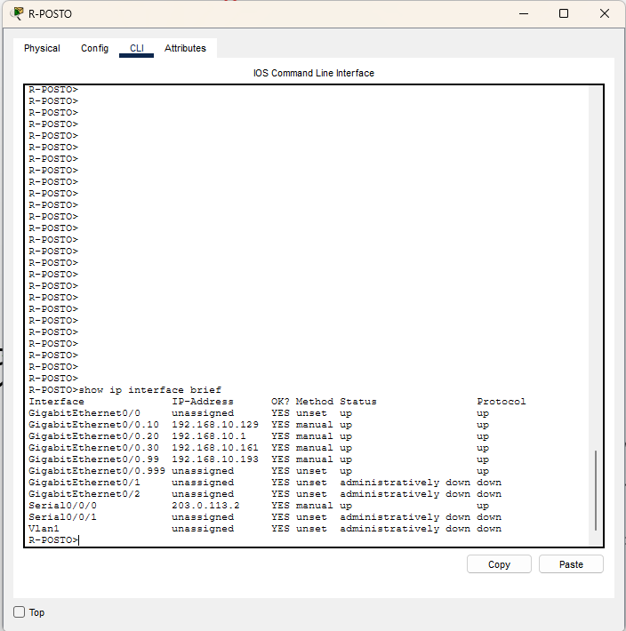

### Teste 2 — VLANs e trunks no SW-CORE
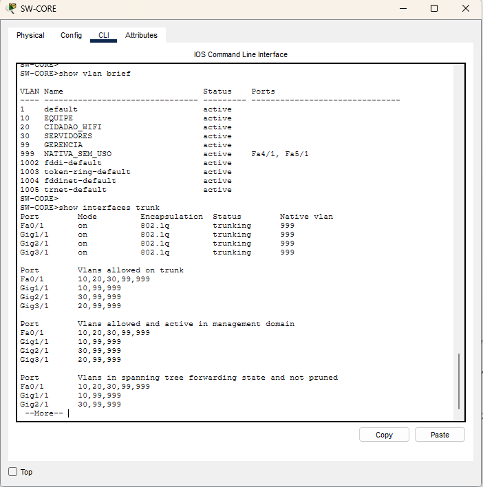

### Teste 3 — Link serial com PPP
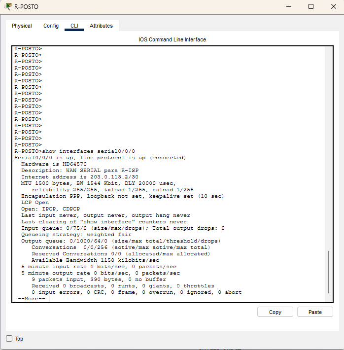

### Teste 4 — DHCP
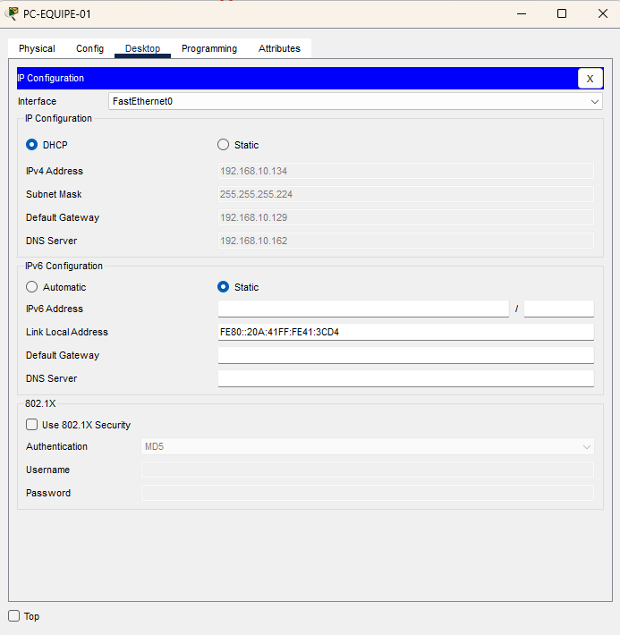

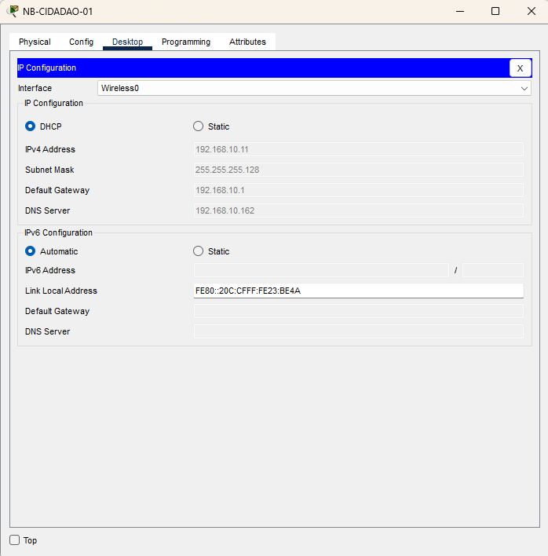

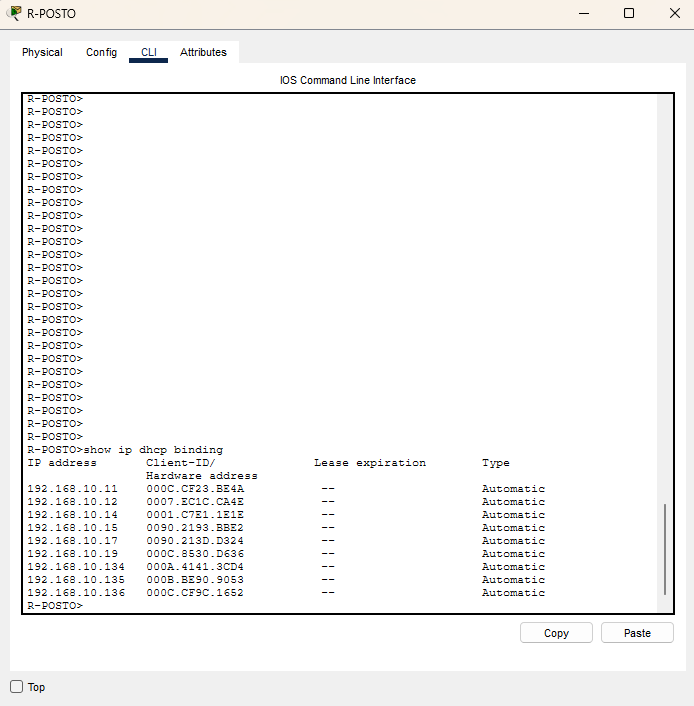

### Teste 6 — Ping entre VLANs
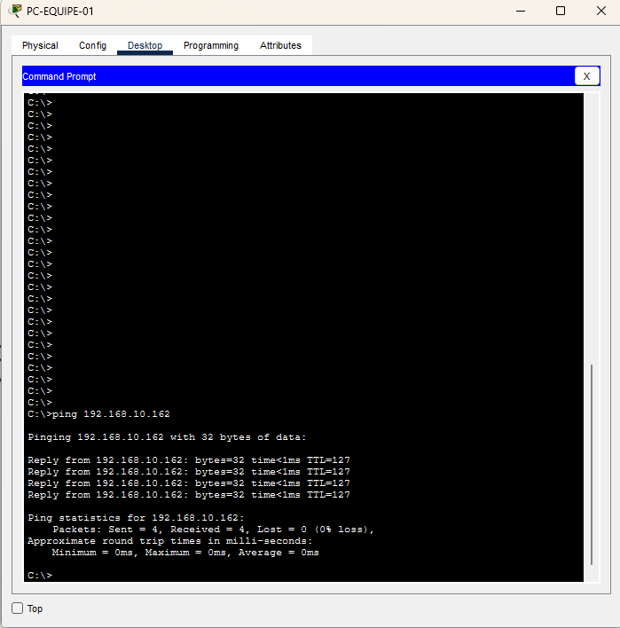

### Teste 7 — Roteamento até a nuvem
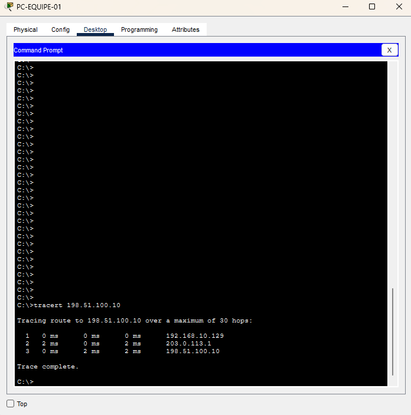

### Teste 8 — DNS e páginas web
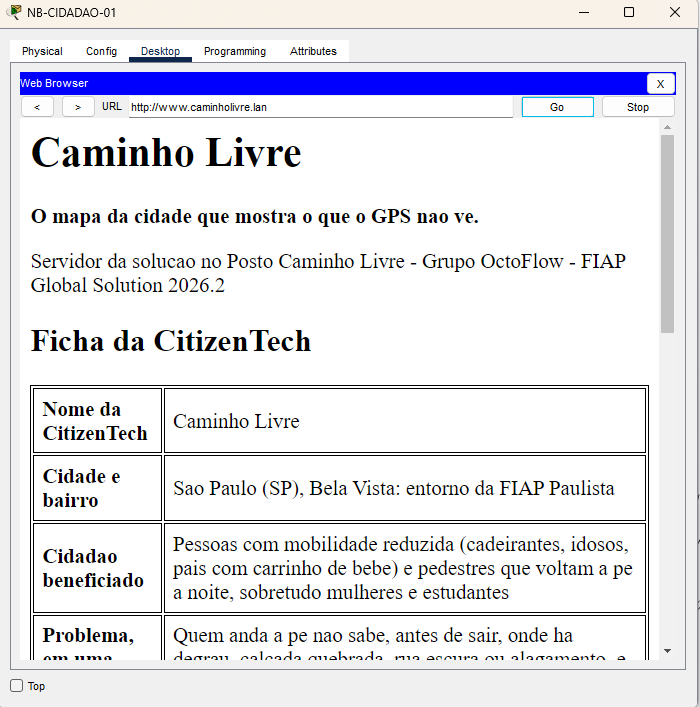

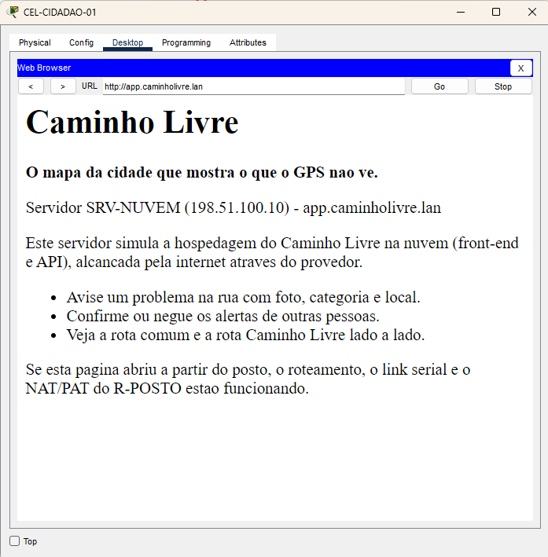

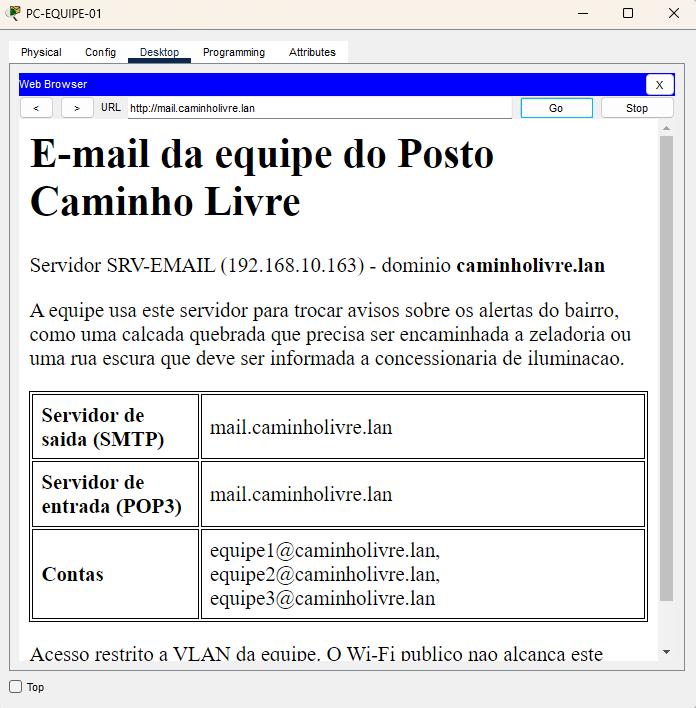

### Teste 9 — E-mail
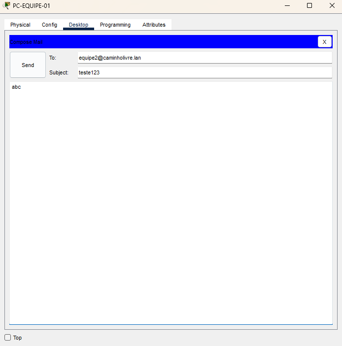

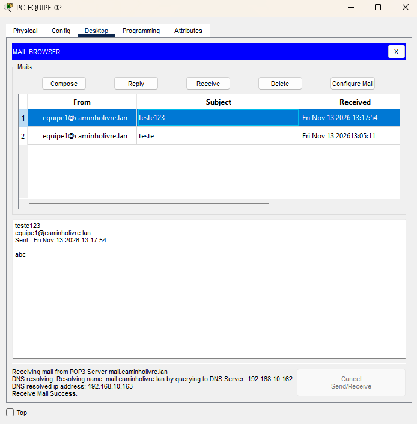

### Teste 10 — NAT/PAT
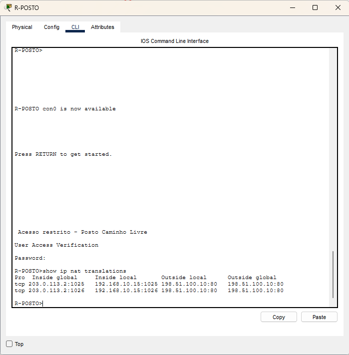

### Teste 11 — ACL bloqueando o Wi-Fi público
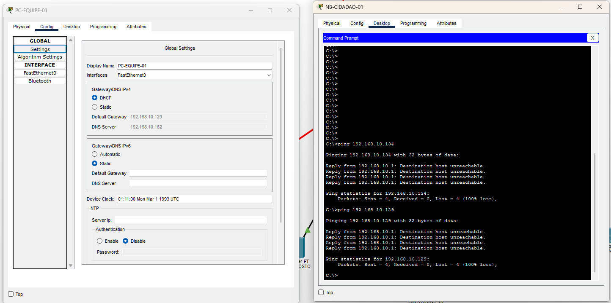

### Teste 12 — Acesso remoto só por SSH
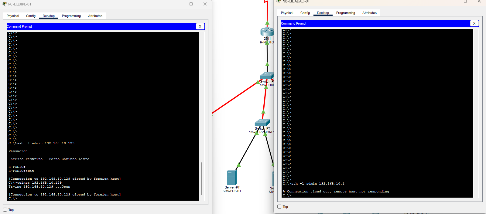

## 10. Registro das decisões

| Decisão | Alternativa considerada | Por que escolhemos |
|---|---|---|
| Um switch central (SW-CORE) e três de acesso, ligados por fibra | Switches em cascata | Cada setor fica fisicamente separado, os uplinks não dependem uns dos outros e dá para crescer adicionando um switch de acesso numa porta de fibra |
| Fibra multimodo entre os switches | Fibra monomodo | Os switches ficam no mesmo prédio, a poucos metros uns dos outros. A multimodo atende distâncias curtas e custa menos; a monomodo só compensa em longas distâncias, entre prédios ou bairros |
| Router-on-a-stick no R-POSTO | Switch multicamada fazendo o inter-VLAN | Um único ponto onde ficam o roteamento, o NAT e a ACL; mais simples de configurar e de auditar |
| VLSM em `192.168.10.0/24` | Um /24 para cada VLAN | Mostra o cálculo das sub-redes, usa só o necessário e ainda sobram blocos para expansão |
| Rota estática padrão | OSPF entre os roteadores | O posto tem um único link de saída e o NAT esconde as redes internas; um protocolo dinâmico não traria ganho |
| DHCP no roteador | DHCP num servidor com `ip helper-address` | Menos dependências: se um servidor cair, os dispositivos continuam recebendo IP |
| AP em modo bridge + ACL no roteador | Roteador wireless | O enunciado pede AP. Com ele, o controle do Wi-Fi público fica no R-POSTO, junto das outras regras |
| PPP com CHAP na serial | HDLC (padrão Cisco) | Autentica o link com o provedor sem custo de configuração relevante |
| Servidor do app na "nuvem", atrás do provedor | Servidor do app dentro do posto | Reflete a solução real: o Caminho Livre roda na nuvem, e o posto só oferece acesso |
| Faixas RFC 5737 nas redes externas | IPs públicos quaisquer | Não colidem com endereços reais |
| Domínio interno `caminholivre.lan` | `caminholivre.local` | O cliente de e-mail do Packet Tracer só aceita endereços que terminam com 2 a 4 letras, e `.local` tem 5. `.lan` é uma terminação usada em redes internas e não existe na internet |

## 11. Expansão

- **Novo setor no posto:** usar os blocos livres `192.168.10.208/28` ou `192.168.10.224/27`, criar a VLAN e uma subinterface no R-POSTO.
- **Mais dispositivos num setor:** ligar um novo switch de acesso por fibra no SW-CORE, que ainda tem portas livres.
- **Outros postos em outros bairros:** repetir o mesmo modelo com outra faixa (`192.168.11.0/24`, `192.168.12.0/24`...), com um roteador de posto ligado ao provedor.
- **Mais usuários no Wi-Fi:** adicionar access points na VLAN 20 sem mudar o endereçamento, porque o /25 comporta 126 dispositivos.

## 12. Conclusão

A rede do Posto Caminho Livre atende todos os requisitos mínimos do enunciado e é coerente com a solução: o cidadão usa o Wi-Fi público para chegar ao app na nuvem, a equipe trabalha numa rede isolada com e-mail próprio, e os servidores do posto só expõem o que o público precisa. A segmentação por VLAN, a ACL do Wi-Fi público, o SSH e o WPA2 protegem a rede, e os testes da seção 9 comprovam cada serviço funcionando.
